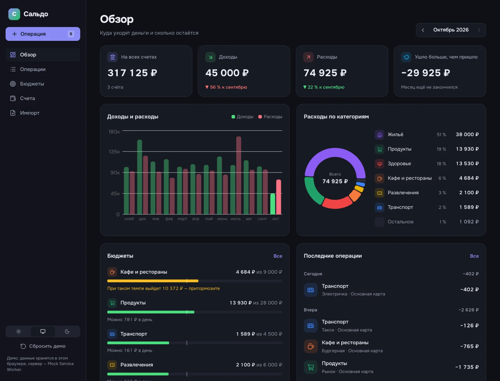
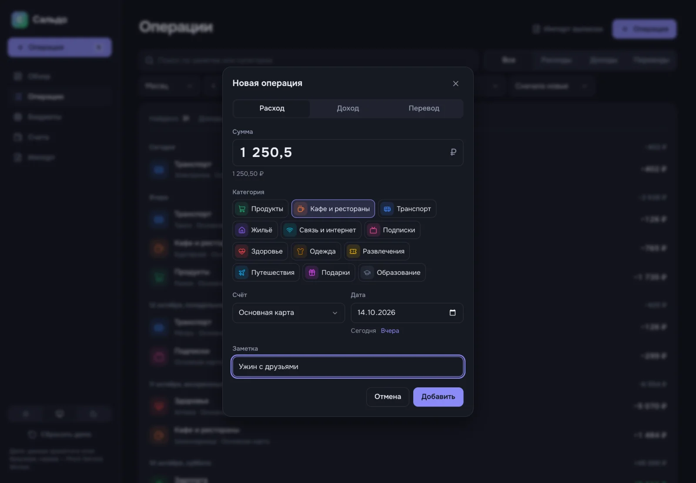
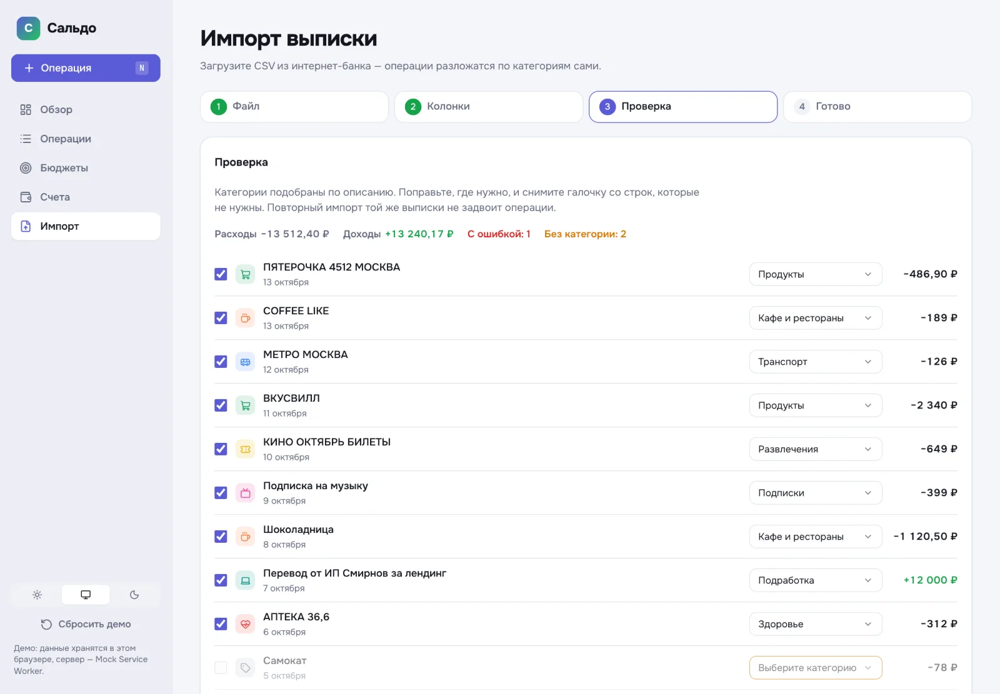
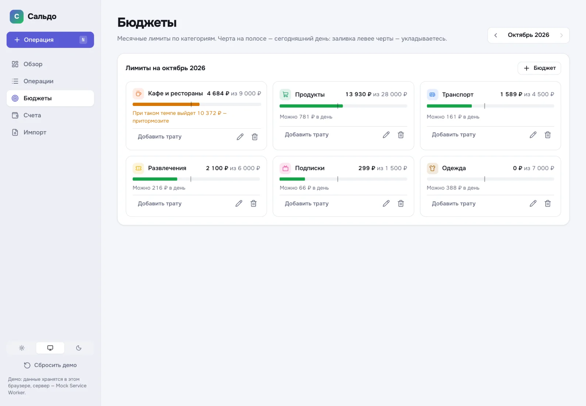
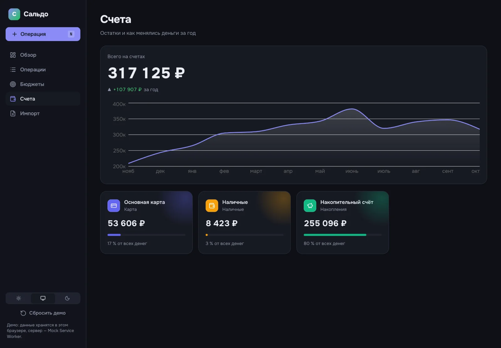
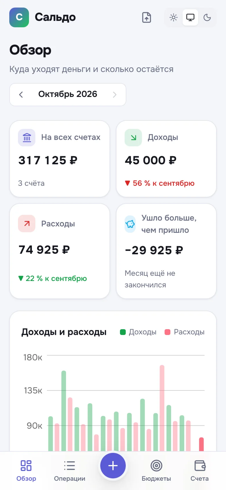
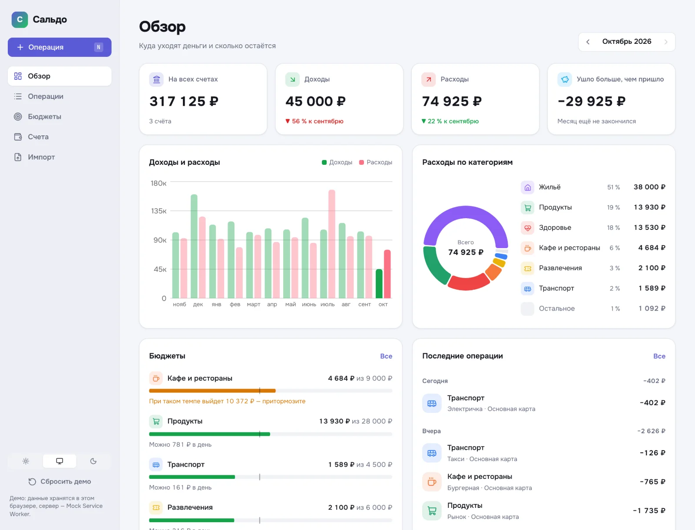

# Сальдо — учёт личных финансов

Операции, бюджеты с темпом трат, графики за год и импорт банковской выписки. Проект показывает
то, что чаще всего спрашивают в вакансиях на React: **Redux Toolkit**, **RTK Query** и
архитектуру **Feature-Sliced Design** — и сделан так, чтобы по нему можно было учиться.

**Демо:** https://dmitriy9427.github.io/saldo/ · **Учебник:** [docs/](docs/README.md)

Бэкенда у демо нет: сервер изображает Mock Service Worker в браузере, данные хранятся в
localStorage. Запросы видны в DevTools → Network как настоящие.



| Новая операция (клавиша N) | Импорт выписки |
| --- | --- |
|  |  |

| Бюджеты: темп трат и прогноз | Счета и баланс за год |
| --- | --- |
|  |  |

## Redux Toolkit и RTK Query

- **Один `createApi`, эндпоинты в сущностях** (`injectEndpoints`). Добавили операцию —
  мутация инвалидирует теги, и сами перезапрашиваются список, остатки, графики и бюджеты.
- **Оптимистичная правка** с откатом при ошибке сервера (`updateQueryData` + `patch.undo()`).
- **Удаление с отменой** на listener middleware: строка исчезает сразу, 5 секунд ждём экшен
  «Отменить» (`listenerApi.take`), потом DELETE; ошибка — строка возвращается.
- **Клиентское состояние** — слайсы: тема (сохраняется listener'ом), тосты на
  `createEntityAdapter`, мастер импорта с мемоизированными селекторами `createSelector`.
- **Что где живёт:** данные сервера — только в кеше RTK Query, фильтры и месяц — в адресе,
  общее клиентское — в слайсах, локальное — в `useState`.

## Feature-Sliced Design

```
app → pages → widgets → features → entities → shared
```

Импорты только вниз, наружу — только `index.ts` слайса, сегменты по назначению. Проверяет
линтер **Steiger** в CI. Строку операции собирает виджет из сущностей и фич — сущности не
знают друг о друге. Решения и спорные места — [docs/04-fsd.md](docs/04-fsd.md).

## Остальное

- **Формы** — react-hook-form + zod 4: сумма строкой («1 250,50»), правила на несколько полей,
  ошибки сервера (422) под полями.
- **Деньги в копейках**, даты строками без часовых поясов, `Intl.NumberFormat`, падежи месяцев.
- **Графики** — Recharts 3: цвета из CSS-переменных (тема без перерисовки), клик по месяцу,
  «бублик» со связанным списком категорий.
- **Импорт CSV** — кодировка UTF-8 / Windows-1251, разделитель и колонки угадываются,
  категории по описанию, дубликаты пропускаются.
- Светлая и тёмная тема, телефон (вкладки и «+» внизу), доступность с клавиатуры,
  ленивые страницы, демо-сервер отдельным файлом.
- **74 теста:** Vitest (функции, слайсы, RTK Query + MSW, фейковые таймеры, Testing Library)
  и Playwright (компьютер и телефон).

| Телефон | Светлая тема |
| --- | --- |
|  |  |

## Запуск

```bash
npm install
npm run dev      # http://localhost:5173
npm run check    # oxlint + Steiger, типы, тесты, сборка
npm run e2e      # Playwright
```

В консоли браузера есть пульт: `__saldo.controls.fail = true` — сервер «падает»,
`__saldo.controls.latency = 2000` — медленная сеть.

## Стек

React 19 · Redux Toolkit 2 · RTK Query · React Router 8 · Feature-Sliced Design (Steiger) ·
react-hook-form · zod 4 · Recharts 3 · SCSS-модули · MSW 3 · Vitest · Testing Library ·
Playwright · TypeScript 7 · Vite 8 · oxlint · GitHub Actions + Pages

## Учебник

[docs/](docs/README.md) — десять глав: Redux Toolkit, RTK Query, FSD, формы, деньги и даты,
графики, импорт, демо-сервер, тесты. Плюс [шестнадцать настоящих багов](docs/lessons.md),
пойманных при разработке, и [шпаргалка к собеседованию](docs/interview.md).

---

Автор — [Дмитрий Рябов](https://dmitriy9427.github.io/resume/). MIT.
