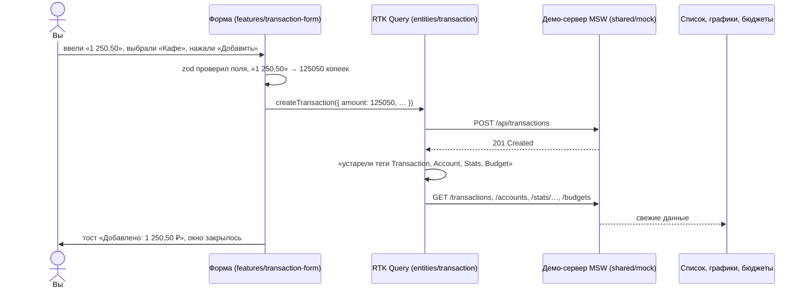

# 00. С чего начать

Этот учебник написан для человека, который знает React (компоненты, `useState`, `useEffect`),
но ещё не работал с Redux, RTK Query и Feature-Sliced Design. Каждая глава устроена одинаково:

1. **Зачем** — какую боль решает инструмент, на бытовом примере.
2. **Самый маленький пример** — 10–20 строк, которые можно понять целиком.
3. **Как это сделано в «Сальдо»** — настоящий код проекта с разбором по строкам.
4. **Ошибки** — что ломается у всех в первый раз.
5. **Попробуйте сами** — маленькие задания с ответами под спойлером.

Читайте с открытым проектом: `npm run dev`, рядом — код. Каждый пример ссылается на файл.

## Картинка целиком

Что происходит, когда вы нажимаете «Добавить» в форме операции:

Обратите внимание на шаг «устарели теги». Ни список, ни график не «знают» про форму, и форма
не знает про них. Они связаны только через **теги**. Это главная идея RTK Query (глава 03).

## Словарь в одну строку

Вернитесь сюда, если встретили незнакомое слово.

| Слово | Простыми словами | Пример в проекте |
| --- | --- | --- |
| **Состояние (state)** | Данные, от которых зависит, что нарисовано на экране | открыта ли форма, какая тема |
| **Store (стор)** | Один большой объект со всем общим состоянием приложения | `makeStore()` в `app/model/store.ts` |
| **Экшен (action)** | Записка «что случилось»: `{ type: 'theme/themeChanged', payload: 'dark' }` | `themeChanged('dark')` |
| **dispatch** | «Отправить записку в стор» | `dispatch(themeChanged('dark'))` |
| **Редьюсер (reducer)** | Функция: старое состояние + записка → новое состояние | `themeChanged: (state, action) => { state.mode = action.payload }` |
| **Слайс (slice)** | Кусок состояния вместе с его редьюсерами и экшенами | `themeSlice`, `toastSlice` |
| **Селектор** | Функция «достань из стора вот это» | `selectThemeMode(state)` → `'dark'` |
| **Middleware** | «Проходная» между dispatch и редьюсером: видит каждый экшен | listener middleware, middleware RTK Query |
| **Запрос (query)** | Получить данные с сервера (GET) | `useGetTransactionsQuery(…)` |
| **Мутация (mutation)** | Изменить данные на сервере (POST/PATCH/DELETE) | `useCreateTransactionMutation()` |
| **Кеш** | Сохранённые ответы сервера, чтобы не спрашивать дважды | `state.api` в Redux DevTools |
| **Тег** | Ярлык на данных в кеше: «это про операции» | `'Transaction'`, `'Budget'` |
| **Инвалидация** | «Ярлык устарел — перезапроси всё с этим ярлыком» | `invalidatesTags: ['Budget']` |
| **Оптимистичное обновление** | Показать результат сразу, не дожидаясь сервера; при ошибке откатить | правка заметки операции |
| **Слой / слайс / сегмент (FSD)** | Этаж / комната / шкаф в комнате | `features` / `transaction-form` / `ui` |
| **Публичный API слайса** | Файл `index.ts`: всё, что можно брать снаружи | `entities/transaction/index.ts` |
| **MSW** | Подделка сервера, которая перехватывает `fetch` прямо в браузере | `shared/mock` |

## Как читать код проекта

- **Комментарий в начале каждого файла** объясняет, зачем файл и почему он сделан так.
  Начинайте читать файл с него.
- **Импорты читаются сверху вниз по слоям:** `@/shared/...` — самый низ (общие кирпичики),
  `@/entities/...` — данные, `@/features/...` — действия, `@/widgets/...` — блоки страниц.
- **Не нашли, где что-то делается?** Ищите по тексту, который видите на экране:
  например, «Операция удалена» → `features/delete-transaction/model/delete-flow.ts`.

## Порядок чтения

| Если вы хотите… | Читайте |
| --- | --- |
| понять Redux с нуля | [02. Redux Toolkit](02-redux-toolkit.md) |
| перестать писать `fetch` в `useEffect` | [03. RTK Query](03-rtk-query.md) |
| понять, куда класть файлы | [04. FSD](04-fsd.md) |
| сделать нормальную форму | [05. Формы](05-forms.md) |
| руками пощупать всё сразу | [Практикум](labs.md) — задания на коде проекта |
