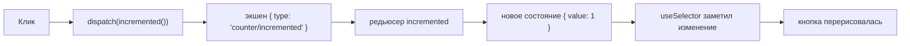
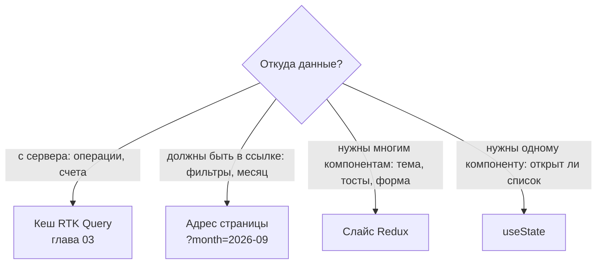
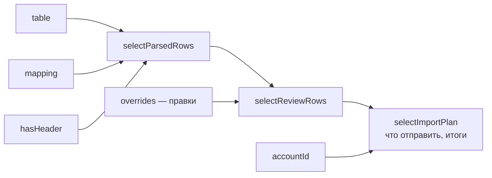
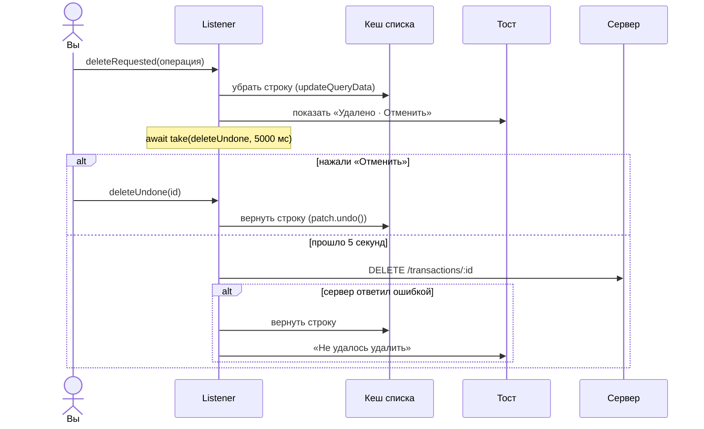

# 02. Redux Toolkit — с нуля

## Зачем вообще Redux

Представьте квартиру, где у каждого члена семьи свой блокнот со списком покупок. Мама
вычеркнула молоко у себя, а папа об этом не знает и покупает второе. Так выглядит приложение,
где одно и то же состояние разложено по `useState` в разных компонентах.

**Redux — это один общий блокнот на холодильнике.** Правила у него простые:

1. Блокнот один — **store**.
2. Писать в него напрямую нельзя. Можно оставить **записку** (экшен): «купили молоко».
3. Записки обрабатывает **один человек по инструкции** (редьюсер) и переписывает блокнот.
4. Любой может **посмотреть** в блокнот (селектор) и узнать, что изменилось.

Почему так строго: всегда понятно, **кто, когда и почему** поменял данные. В Redux DevTools
видна вся история записок, и любую можно «отмотать».

## Самый маленький пример

Счётчик на `useState`:

```tsx
function Counter() {
  const [count, setCount] = useState(0)
  return <button onClick={() => setCount(count + 1)}>{count}</button>
}
```

Пока счётчик нужен одному компоненту, это лучший вариант. Но если то же число нужно в шапке,
в боковой панели и в модалке, `useState` придётся поднимать всё выше и передавать пропсами.

Тот же счётчик на Redux Toolkit:

```tsx
// 1. Слайс: кусок состояния + что с ним можно делать.
const counterSlice = createSlice({
  name: 'counter',                       // имя — будет в типе экшена: 'counter/incremented'
  initialState: { value: 0 },            // с чего начинаем
  reducers: {
    incremented: (state) => {            // «инструкция» для записки 'counter/incremented'
      state.value += 1                   // выглядит как изменение, но см. «Immer» ниже
    },
    added: (state, action: PayloadAction<number>) => {
      state.value += action.payload      // payload — то, что передали: added(5)
    },
  },
})

// 2. Store — общий блокнот.
const store = configureStore({ reducer: { counter: counterSlice.reducer } })

// 3. Компонент: смотрит в блокнот и оставляет записки.
function Counter() {
  const value = useSelector((state: RootState) => state.counter.value)   // посмотреть
  const dispatch = useDispatch()
  return <button onClick={() => dispatch(counterSlice.actions.incremented())}>{value}</button> // записка
}

// 4. Где-то наверху: <Provider store={store}><App /></Provider>
```

Что происходит при клике:



### Immer: почему можно писать `state.value += 1`

В «чистом» Redux состояние менять нельзя, нужно возвращать новый объект:

```ts
// Старый Redux: копируем вручную на каждом уровне вложенности.
return { ...state, filters: { ...state.filters, month: '2026-09' } }
```

Redux Toolkit внутри использует библиотеку **Immer**. Она даёт вам «черновик» (`state`),
следит, что вы в нём поменяли, и сама собирает новый объект. Вы пишете
`state.filters.month = '2026-09'`, а получаете честную неизменяемую копию.

> **Ошибка №1.** Immer работает, только если вы **либо** меняете черновик, **либо**
> возвращаете новое значение, но не то и другое сразу:
> ```ts
> reducer: (state) => { state.a = 1; return { b: 2 } }   // ✗ ошибка Immer
> reducer: (state) => ({ ...state, a: 1 })               // ✓ вернули новое
> reducer: (state) => { state.a = 1 }                    // ✓ поменяли черновик
> ```

## Что класть в Redux, а что нет

Самый важный вопрос, и задают его на каждом собеседовании. В «Сальдо» правило такое:



> **Ошибка №2 (самая частая).** Скопировать ответ сервера в слайс:
> ```ts
> const data = await fetch('/api/transactions').then((r) => r.json())
> dispatch(transactionsLoaded(data))      // ✗ теперь у данных два хозяина
> ```
> Сервер изменился, слайс нет — на экране старые данные. Для данных с сервера есть RTK Query.

## Как это сделано в «Сальдо»

### Store — [app/model/store.ts](../src/app/model/store.ts)

```ts
const rootReducer = combineSlices(baseApi, toastSlice, themeSlice, importSlice, transactionFormSlice)

export function makeStore(preloadedState?) {
  const store = configureStore({
    reducer: rootReducer,
    preloadedState,
    middleware: (getDefault) =>
      getDefault()
        .prepend(listenerMiddleware.middleware)   // реакции на экшены (ниже)
        .concat(baseApi.middleware),              // кеш и запросы RTK Query
  })
  setupListeners(store.dispatch)                  // перезапрос при возврате на вкладку
  return store
}
```

Построчно:

- `combineSlices(...)` — собрать блокнот из кусков. Имя каждого куска берётся из
  `slice.name`: в состоянии будет `state.toasts`, `state.theme`, `state.import`…
  Откройте Redux DevTools → вкладка **State**, и вы увидите ровно эти ключи.
- `makeStore` — **функция**, а не готовый store. В тестах каждый тест создаёт свой чистый
  store, и тесты не мешают друг другу.
- `getDefault()` — стандартный набор middleware. В режиме разработки он ругается, если вы
  случайно изменили состояние вне редьюсера или положили в него функцию.
- `prepend` / `concat` — поставить свой middleware в начало или в конец цепочки.

### Слайс темы — [features/toggle-theme/model/theme-slice.ts](../src/features/toggle-theme/model/theme-slice.ts)

Самый простой слайс в проекте, начните с него:

```ts
export const themeSlice = createSlice({
  name: 'theme',
  initialState: () => ({ mode: readSaved() }),      // ①
  reducers: {
    themeChanged: (state, action: PayloadAction<ThemeMode>) => {
      state.mode = action.payload                   // ②
    },
  },
  selectors: {
    selectThemeMode: (state) => state.mode,         // ③
  },
})
export const { themeChanged } = themeSlice.actions
export const { selectThemeMode } = themeSlice.selectors
```

- ① `initialState` — **функция**. localStorage прочитается в момент создания store, а не
  при импорте файла. В тестах так можно подложить нужное значение до создания store.
- ② Только присваивание, никакой записи в localStorage. Почему — ниже, в разделе
  «Listener middleware».
- ③ Селектор внутри слайса получает **только кусок** `state.theme`, а не всё состояние.
  Снаружи его вызывают как обычно: `useAppSelector(selectThemeMode)`.

Использование в компоненте ([theme-toggle.tsx](../src/features/toggle-theme/ui/theme-toggle.tsx)):

```tsx
const mode = useAppSelector(selectThemeMode)       // 'light' | 'dark' | 'system'
const dispatch = useAppDispatch()
<button onClick={() => dispatch(themeChanged('dark'))} aria-checked={mode === 'dark'} />
```

### Слайс тостов — [shared/model/toast.ts](../src/shared/model/toast.ts)

Здесь три новых приёма сразу. Разберём по одному.

**1. `createEntityAdapter` — готовый «список с id».** Список тостов можно хранить массивом:

```ts
[{ id: 'a', message: 'Добавлено' }, { id: 'b', message: 'Удалено' }]
// удалить 'b' → пройти весь массив; найти 'a' → пройти весь массив
```

Адаптер хранит иначе — как картотеку с оглавлением:

```ts
{
  ids: ['a', 'b'],                                 // порядок
  entities: {                                      // быстрый доступ по id
    a: { id: 'a', message: 'Добавлено' },
    b: { id: 'b', message: 'Удалено' },
  },
}
```

И даёт готовые функции, их не нужно писать самому:

```ts
const adapter = createEntityAdapter<Toast>()

adapter.getInitialState()          // { ids: [], entities: {} }
adapter.addOne(state, toast)       // добавить
adapter.removeOne(state, 'b')      // удалить по id
adapter.getSelectors().selectAll   // → массив в порядке ids
```

**2. `prepare` — подготовить записку перед отправкой.** У каждого тоста должен быть
уникальный id. Где его создать?

```ts
toastShown: {
  reducer: (state, action: PayloadAction<Toast>) => {
    adapter.addOne(state, action.payload)
    if (state.ids.length > 3) adapter.removeOne(state, state.ids[0]!)  // не больше трёх
  },
  prepare: (toast) => ({
    payload: { id: nanoid(), tone: 'success', duration: 4000, ...toast },
  }),
},
```

Вызов `toastShown({ message: 'Готово' })` сначала проходит через `prepare` и превращается в
`{ type: 'toasts/toastShown', payload: { id: 'V1StGXR8', tone: 'success', duration: 4000, message: 'Готово' } }`.
Только потом записка попадает в редьюсер.

> **Почему не `nanoid()` прямо в редьюсере?** Редьюсер обязан быть **чистой функцией**:
> одни и те же входные данные → один и тот же результат. Иначе ломается «перемотка» в
> DevTools: при повторе той же записки получится другой id. Всё случайное (id, `Date.now()`)
> — в `prepare` или в компоненте.

**3. В состоянии — только данные, никаких функций.** У тоста есть кнопка «Отменить». Хочется
написать так:

```ts
toastShown({ message: 'Удалено', onAction: () => restore(id) })   // ✗ функция в сторе
```

Но функцию нельзя сохранить, показать в DevTools и сравнить. Поэтому кнопка хранит
**записку**, которую надо отправить при нажатии:

```ts
toastShown({ message: 'Удалено', action: { label: 'Отменить', action: deleteUndone(id) } })  // ✓
```

А [Toaster](../src/shared/ui/toaster.tsx) при нажатии просто делает `dispatch(toast.action.action)`.

## createSelector — вычислять, а не хранить

### Зачем

Задача: в мастере импорта показать строки выписки с категориями. Можно хранить в слайсе и
таблицу, и готовые строки. Но тогда при смене колонки «Сумма» нужно не забыть пересобрать
строки, а при правке категории — их тоже. Однажды забудете, и данные разъедутся.

**Правило: храните исходное, а производное вычисляйте.**

### Самый маленький пример

```ts
const selectItems = (state) => state.cart.items
const selectTotal = createSelector([selectItems], (items) => {
  console.log('считаю')                                  // увидим, сколько раз
  return items.reduce((sum, i) => sum + i.price, 0)
})

selectTotal(state)   // «считаю» → 300
selectTotal(state)   // (тишина) → 300 — вход тот же, взяли сохранённый результат
// добавили товар: state.cart.items — новый массив
selectTotal(state)   // «считаю» → 450
```

`createSelector` запоминает последний вход и выход. Тот же вход **по ссылке** — тот же
результат, без пересчёта. Это важно и для React: `useSelector` перерисует компонент, только
если результат изменился по ссылке.

### В «Сальдо» — [import-slice.ts](../src/features/import-statement/model/import-slice.ts)

В слайсе лежит только исходное: таблица из файла, какая колонка за что отвечает, правки
пользователя. Остальное — цепочка селекторов:



- Поменяли категорию в одной строке → изменился только `overrides` → пересчитаются
  `selectReviewRows` и `selectImportPlan`, а разбор таблицы (`selectParsedRows`) — нет.
- Пришёл посторонний экшен (например, тост) → ни один вход не изменился → ничего не
  пересчитывается. Тест [import-slice.test.ts](../src/features/import-statement/model/import-slice.test.ts)
  проверяет именно это: `expect(selectReviewRows(state)).toBe(тот же массив)`.

> **Ошибка №3.** Селектор, который каждый раз возвращает **новый** объект:
> ```ts
> useSelector((state) => ({ mode: state.theme.mode }))   // ✗ новый объект → перерисовка всегда
> useSelector((state) => state.theme.mode)               // ✓ строка — сравнивается по значению
> ```
> React-Redux даже предупредит об этом в консоли в режиме разработки.

## Listener middleware — «когда случится X, сделай Y»

### Зачем

Редьюсер должен быть чистым: нельзя писать в localStorage, ходить на сервер, ставить
таймеры. Где тогда делать такие вещи? Есть три варианта:

| Где | Плохо, потому что |
| --- | --- |
| в компоненте (`useEffect`) | компонент исчез с экрана — его таймеры и обработчики пропали |
| в редьюсере | нарушает чистоту, ломает DevTools и тесты |
| **в listener middleware** | ✓ живёт в store, видит все экшены, умеет ждать |

### Самый маленький пример

```ts
startAppListening({
  actionCreator: themeChanged,                  // когда пришла записка themeChanged…
  effect: (action) => {                         // …сделай это
    localStorage.setItem('saldo:theme', action.payload)
  },
})
```

Это настоящий код из `theme-slice.ts`, только без проверок. Редьюсер меняет тему, а
listener сохраняет её на диск.

### Сценарий посложнее: удаление с отменой

[features/delete-transaction/model/delete-flow.ts](../src/features/delete-transaction/model/delete-flow.ts).
Нажали корзину → строка исчезла → внизу тост «Операция удалена · Отменить» → 5 секунд можно
передумать → потом удаление на сервере.



Ключевая строка — ожидание:

```ts
const undone = await api.take(
  (action) => deleteUndone.match(action) && action.payload === id,  // какую записку ждём
  UNDO_MS,                                                         // сколько ждём
)
// undone — сама записка, если её прислали; null — если время вышло
```

`take` — это «поставь будильник и жди письма». Пришло письмо — проснулись с письмом. Не
пришло за 5 секунд — проснулись с `null`.

> **Почему не `setTimeout` в компоненте строки?** Строку убрали из списка — компонент
> исчез вместе со своим таймером, и DELETE никогда не уйдёт. Listener живёт в store, ему
> всё равно, что сейчас на экране.

## Типы: useAppSelector и useAppDispatch

Обычный `useSelector` не знает, как устроено ваше состояние:

```ts
const mode = useSelector((state) => state.theme.mode)   // state: unknown — ошибка TS
```

Поэтому делают типизированные версии один раз
([shared/model/hooks.ts](../src/shared/model/hooks.ts)):

```ts
export const useAppSelector = useSelector.withTypes<RootState>()
export const useAppDispatch = useDispatch.withTypes<AppDispatch>()
```

Откуда взять `RootState`, если store собирается в `app`, а хуки лежат ниже, в `shared`
(импортировать снизу вверх по правилам FSD нельзя)? Объявить тип **глобальным**
([app/model/global.d.ts](../src/app/model/global.d.ts)):

```ts
declare global {
  type RootState = RootStateType        // «тип RootState виден во всём проекте без импорта»
  type AppDispatch = AppStore['dispatch']
}
```

Типы исчезают при сборке, поэтому зависимости «shared → app» в готовом коде нет.

## Шпаргалка: что выбрать для побочных эффектов

| Задача | Инструмент |
| --- | --- |
| Получить или изменить данные на сервере | RTK Query |
| «Когда случится X — сделай Y», сохранить в localStorage | listener middleware |
| Сценарий с ожиданием: подождать, отменить, повторить | listener middleware (`take`, `delay`, `condition`) |
| Разовое асинхронное действие по кнопке, без кеша | `createAsyncThunk` |

## Попробуйте сами

1. Откройте демо и Redux DevTools (расширение для браузера). Переключите тему. Какой
   `type` у экшена и что лежит в `payload`?
2. Добавьте в слайс темы экшен `themeReset`, который возвращает `'system'`.
3. Почему `selectToasts` возвращает тот же массив, если пришёл экшен из другого слайса?
4. Удалите операцию и сразу нажмите «Отменить». Какие экшены вы видите в DevTools и в каком порядке?

<details>
<summary>Ответы</summary>

1. `type: 'theme/themeChanged'`, `payload: 'dark'` (или `'light'`/`'system'`).
2. ```ts
   themeReset: (state) => { state.mode = 'system' },
   ```
   И экспортировать: `export const { themeChanged, themeReset } = themeSlice.actions`.
   Listener сохранения темы не сработает — он слушает только `themeChanged`. Чтобы слушать
   оба, используйте `matcher: isAnyOf(themeChanged, themeReset)`.
3. Redux Toolkit не трогает куски состояния, которые не менялись: `state.toasts` остаётся
   тем же объектом, а адаптер возвращает сохранённый массив.
4. `deleteTransaction/requested` → `api/queries/queryResultPatched` (правка кеша) → `toasts/toastShown` →
   `deleteTransaction/undone` → `toasts/toastDismissed`. Запроса `DELETE` не будет.
</details>
