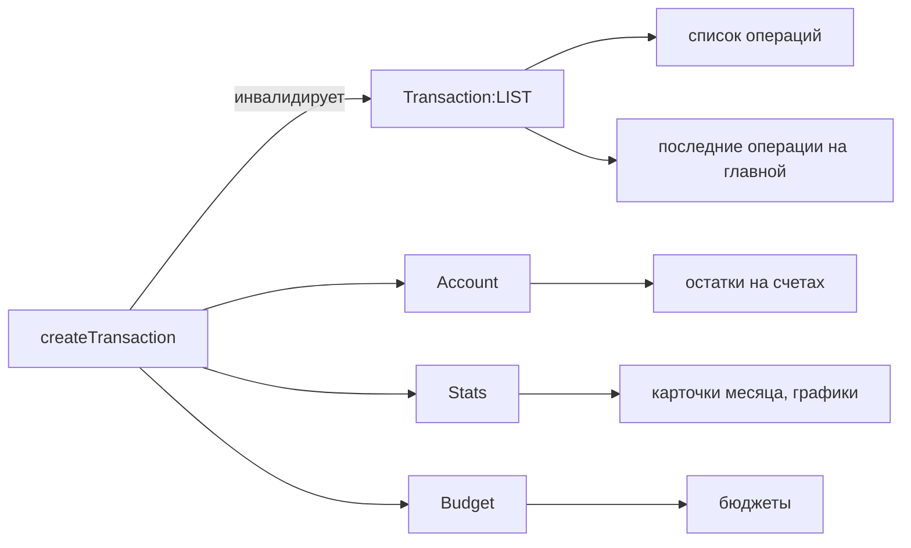
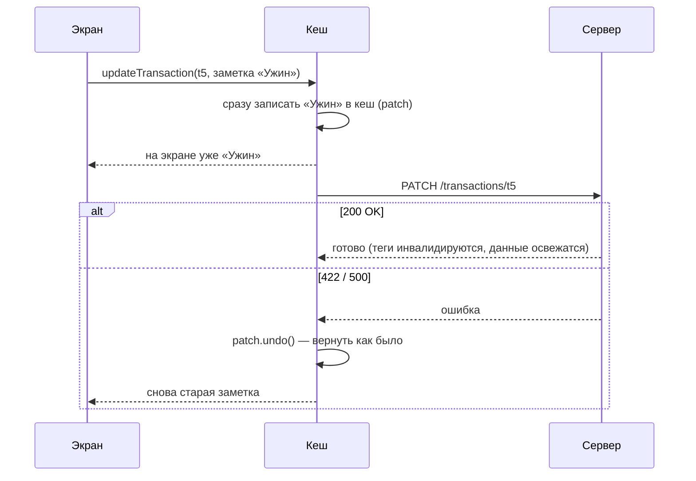

# 03. RTK Query — с нуля

## Зачем

Вот как обычно загружают данные в React:

```tsx
function TransactionList() {
  const [data, setData] = useState(null)
  const [loading, setLoading] = useState(true)
  const [error, setError] = useState(null)

  useEffect(() => {
    setLoading(true)
    fetch('/api/transactions')
      .then((r) => r.json())
      .then(setData)
      .catch(setError)
      .finally(() => setLoading(false))
  }, [])

  if (loading) return <Spinner />
  if (error) return <Error />
  return <List items={data.items} />
}
```

Выглядит нормально, но у этого кода семь проблем:

| # | Проблема | Что видит пользователь |
| --- | --- | --- |
| 1 | Нет кеша | ушли со страницы и вернулись — снова спиннер |
| 2 | Нет общего доступа | список и счётчик в шапке делают **два одинаковых** запроса |
| 3 | Гонка ответов | быстро переключили месяц: ответ за сентябрь пришёл **после** октябрьского и затёр его |
| 4 | Нет обновления после изменений | добавили операцию — список старый, пока не обновишь страницу |
| 5 | Нет перезапроса | вернулись на вкладку через час — данные часовой давности |
| 6 | Повтор кода | три `useState` и `useEffect` в каждом компоненте с данными |
| 7 | Утечки | компонент исчез, а `setData` вызывается после ответа |

**RTK Query решает всё это за вас.** Тот же компонент:

```tsx
function TransactionList() {
  const { data, isLoading, error } = useGetTransactionsQuery({ month: '2026-10' })
  if (isLoading) return <Spinner />
  if (error) return <Error />
  return <List items={data.items} />
}
```

## Самый маленький пример

```ts
// 1. Описываем API один раз.
const api = createApi({
  baseQuery: fetchBaseQuery({ baseUrl: '/api' }),   // как ходить на сервер (обёртка над fetch)
  endpoints: (build) => ({
    getTodos: build.query<Todo[], void>({            // <что вернёт, что принимает>
      query: () => 'todos',                          // GET /api/todos
    }),
    addTodo: build.mutation<Todo, string>({
      query: (title) => ({ url: 'todos', method: 'POST', body: { title } }),
    }),
  }),
})

// 2. RTK Query сам сгенерировал хуки по именам эндпоинтов:
export const { useGetTodosQuery, useAddTodoMutation } = api
//   getTodos → useGetTodosQuery,  addTodo → useAddTodoMutation

// 3. Подключаем к store.
configureStore({
  reducer: { [api.reducerPath]: api.reducer },
  middleware: (getDefault) => getDefault().concat(api.middleware),
})
```

```tsx
// 4. Пользуемся.
function Todos() {
  const { data = [], isLoading } = useGetTodosQuery()
  const [addTodo, { isLoading: saving }] = useAddTodoMutation()
  return (
    <>
      {data.map((t) => <p key={t.id}>{t.title}</p>)}
      <button disabled={saving} onClick={() => addTodo('Купить молоко')}>Добавить</button>
    </>
  )
}
```

Пока нет одного: после `addTodo` список не обновится. Для этого нужны **теги** — о них ниже.

## Что возвращает хук запроса

`useGetTransactionsQuery(аргумент)` возвращает объект. Главные поля:

| Поле | Что значит |
| --- | --- |
| `data` | последний успешный ответ (или `undefined`) |
| `isLoading` | данных **ещё нет совсем**, идёт первый запрос |
| `isFetching` | идёт **любой** запрос, в том числе фоновое обновление |
| `isError`, `error` | запрос упал; в `error.status` — код (404, 500) или `'FETCH_ERROR'` |
| `refetch()` | перезапросить вручную (кнопка «Повторить») |

Разница между `isLoading` и `isFetching` на шкале времени — переключаем месяц с октября на сентябрь:

```
время →         открыли страницу      ответ     сменили месяц     ответ
isLoading       ████████████████░░░░░░░░░░░░░░░░░░░░░░░░░░░░░░░░░░░░░░░░
isFetching      ████████████████░░░░░░░░░░░░░██████████████████░░░░░░░░
data            undefined       │ октябрь ──────────────────────│ сентябрь
что на экране   скелетоны       │ октябрь   │ октябрь бледный   │ сентябрь
```

В «Сальдо» так и сделано: при `isLoading` — серые заглушки, при `isFetching` со старыми
данными — старые данные полупрозрачные ([month-summary.tsx](../src/widgets/month-summary/ui/month-summary.tsx)):

```tsx
<div className={cx(s.grid, summary.isFetching && !summary.isLoading && s.stale)}>
```

## Кеш: ключ — это аргумент

```ts
useGetTransactionsQuery({ month: '2026-10', page: 1 })   // запись кеша №1
useGetTransactionsQuery({ month: '2026-10', page: 2 })   // запись кеша №2
useGetTransactionsQuery({ page: 1, month: '2026-10' })   // снова №1 — порядок ключей не важен
```

- **Два компонента с одинаковым аргументом** → один запрос на сервер, данные общие. На главной
  «Сальдо» карточки месяца и «бублик» категорий оба вызывают `useGetMonthSummaryQuery(month)`.
  Откройте Network: `/stats/summary` там один.
- **Вернулись на страницу 1** → данные уже в кеше, показываются мгновенно.
- **Никто больше не смотрит** на запись → она живёт ещё `keepUnusedDataFor` секунд
  (в «Сальдо» 60), потом удаляется.

Посмотреть кеш глазами: Redux DevTools → State → `api` → `queries`.

## Теги — как RTK Query понимает, что перезапросить

### Аналогия

Представьте библиотеку. На каждой книге наклейка: «Операции», «Бюджеты», «Счета». Когда
приходит новость «операции изменились», библиотекарь снимает с полки **все книги с
наклейкой «Операции»** и заказывает свежие.

- **Запрос наклеивает ярлыки** на свои данные — `providesTags`.
- **Мутация объявляет ярлыки устаревшими** — `invalidatesTags`.

### Самый маленький пример

```ts
const api = createApi({
  baseQuery: fetchBaseQuery({ baseUrl: '/api' }),
  tagTypes: ['Todo'],                                  // объявили виды ярлыков
  endpoints: (build) => ({
    getTodos: build.query<Todo[], void>({
      query: () => 'todos',
      providesTags: ['Todo'],                          // «мои данные — про Todo»
    }),
    addTodo: build.mutation<Todo, string>({
      query: (title) => ({ url: 'todos', method: 'POST', body: { title } }),
      invalidatesTags: ['Todo'],                       // «всё про Todo устарело»
    }),
  }),
})
```

Теперь после `addTodo('…')` список перезапросится сам.

### В «Сальдо»: точные ярлыки

Ярлык может быть общим (`'Account'`) или точным (`{ type: 'Transaction', id: 't42' }`).
Список операций наклеивает **оба вида**
([transaction-api.ts](../src/entities/transaction/api/transaction-api.ts)):

```ts
getTransactions: build.query<TransactionPage, TransactionQuery>({
  query: (query) => `transactions?${toSearchParams(query)}`,
  providesTags: (result) => [
    { type: 'Transaction', id: 'LIST' },                                  // «я — список»
    ...(result?.items.map((t) => ({ type: 'Transaction', id: t.id })) ?? []),  // «во мне t1, t5, t9…»
  ],
}),
```

Допустим, на экране открыта первая страница с операциями `t1`, `t5`, `t9`. Её ярлыки:
`Transaction:LIST`, `Transaction:t1`, `Transaction:t5`, `Transaction:t9`.

| Что случилось | Мутация инвалидирует | Перезапросится ли эта страница? |
| --- | --- | --- |
| создали новую операцию | `Transaction:LIST` | да — новая может попасть сюда |
| изменили `t5` | `Transaction:t5` + `LIST` | да — `t5` здесь есть |
| изменили бюджет | `Budget` | нет — ярлыка `Budget` здесь нет |

### Одна мутация — много экранов

Новая операция меняет не только список. Меняются остатки на счетах, графики и «потрачено» в
бюджетах. Поэтому мутации операций инвалидируют сразу четыре вида ярлыков:

```ts
const MONEY_TAGS = [{ type: 'Transaction', id: 'LIST' }, 'Account', 'Stats', 'Budget']

createTransaction: build.mutation<Transaction, TransactionInput>({
  query: (body) => ({ url: 'transactions', method: 'POST', body }),
  invalidatesTags: MONEY_TAGS,
}),
```



Поэтому форма ничего не знает про графики, а графики — про форму. Добавьте новый экран с
ярлыком `Stats`, и он тоже начнёт обновляться сам.

> **Ошибка №1.** Забыть `tagTypes` в `createApi`: TypeScript ругнётся, что тега `'Budget'` нет.
> **Ошибка №2.** Инвалидировать при ошибке. Если сервер ответил 422, данные не изменились,
> и перезапрашивать незачем:
> ```ts
> invalidatesTags: (result, error, { id }) => (error ? [] : [{ type: 'Transaction', id }, ...MONEY_TAGS])
> ```

## Один createApi на всё приложение

Можно сделать `transactionApi = createApi(...)`, `budgetApi = createApi(...)`… Но тогда у
каждого будет **свой** кеш и свои ярлыки, и мутация операции не сможет сказать «бюджеты
устарели». Поэтому в «Сальдо» `createApi` один — пустой, в `shared`
([shared/api/base.ts](../src/shared/api/base.ts)):

```ts
export const baseApi = createApi({
  reducerPath: 'api',
  baseQuery: fetchBaseQuery({ baseUrl: API_URL }),
  tagTypes: ['Transaction', 'Account', 'Category', 'Stats', 'Budget'],
  endpoints: () => ({}),                     // пусто!
})
```

А каждая сущность **дописывает** свои эндпоинты:

```ts
// entities/budget/api/budget-api.ts
export const budgetApi = baseApi.injectEndpoints({
  endpoints: (build) => ({
    getBudgets: build.query<BudgetStatus[], MonthKey>({ … providesTags: ['Budget'] }),
  }),
})
```

Это одновременно и требование FSD: `shared` не знает о бюджетах, а бюджеты расширяют `shared`.

## Мутация в компоненте

```tsx
const [create, { isLoading }] = useCreateTransactionMutation()

async function onSubmit(values) {
  try {
    await create(toInput(values)).unwrap()      // unwrap: ошибка → исключение
    toast('Добавлено')
    close()
  } catch (error) {
    // error.status === 422 → показать ошибки под полями (глава 05)
  }
}
```

Без `.unwrap()` вызов `create(...)` **никогда не бросает** исключение, а возвращает
`{ data }` или `{ error }`. С `.unwrap()` удобнее: успех идёт дальше, ошибка — в `catch`.

## Оптимистичное обновление

### Зачем

Вы поправили заметку и нажали «Сохранить». Сервер отвечает через 300 мс. Можно 300 мс
показывать спиннер, а можно **сразу** показать новую заметку и откатить, только если сервер
откажет. Второй вариант ощущается мгновенным: так работают Telegram, Gmail, Notion.

### Как это работает



### Код с разбором — [transaction-api.ts](../src/entities/transaction/api/transaction-api.ts)

Код ниже немного сокращён: в файле так же правится запись `getTransaction` (одна операция).

```ts
updateTransaction: build.mutation<Transaction, { id: ID; patch: Partial<TransactionInput> }>({
  query: ({ id, patch }) => ({ url: `transactions/${id}`, method: 'PATCH', body: patch }),

  async onQueryStarted({ id, patch }, { dispatch, getState, queryFulfilled }) {
    // ① Где в кеше лежит эта операция? Во всех записях с ярлыком Transaction:id.
    const patches = transactionApi.util
      .selectInvalidatedBy(getState(), [{ type: 'Transaction', id }])
      .map(({ endpointName, originalArgs }) => {
        if (endpointName !== 'getTransactions') return null
        // ② Поправить каждую такую запись прямо сейчас.
        return dispatch(
          transactionApi.util.updateQueryData('getTransactions', originalArgs, (draft) => {
            const item = draft.items.find((t) => t.id === id)
            if (item) Object.assign(item, patch)          // Immer-черновик, как в редьюсере
          }),
        )
      })
    try {
      await queryFulfilled                                 // ③ ждём ответ сервера
    } catch {
      patches.forEach((p) => p?.undo())                    // ④ ошибка — откатить всё
    }
  },
})
```

- ① `onQueryStarted` вызывается **в момент нажатия**, до ответа сервера.
- ① `selectInvalidatedBy` отвечает на вопрос «какие записи кеша перезапросились бы от этого
  ярлыка». Это ровно те места, где операция видна на экране: страница 1, страница 3, поиск…
- ② `updateQueryData` правит запись кеша и возвращает объект с методом `undo()`.
- ④ Откат — просто `undo()` у каждой правки.

Тест, который это проверяет: [transaction-api.test.ts](../src/entities/transaction/api/transaction-api.test.ts),
«правка видна сразу и откатывается, если сервер отказал».

## selectFromResult — взять из ответа только нужное

Категории нужны многим компонентам в виде словаря «id → категория». Можно в каждом
компоненте писать `useMemo(() => new Map(...), [data])`, а можно один раз
([category-api.ts](../src/entities/category/api/category-api.ts)):

```ts
export function useCategoryMap() {
  return useGetCategoriesQuery(undefined, {
    selectFromResult: ({ data = EMPTY }) => ({ categories: data, byId: indexById(data) }),
  })
}
```

Компонент перерисуется, только если изменилось то, что вернул `selectFromResult`. Поэтому
важны **стабильные ссылки**: `EMPTY` — одна константа, а не новый `[]` на каждый вызов, и
словарь `indexById` кешируется по массиву.

## Ошибки запросов

`fetchBaseQuery` не бросает исключения, а кладёт ошибку в `error`:

```ts
error = { status: 422, data: { message: 'Проверьте поля', fields: { amount: '…' } } }  // ответ сервера
error = { status: 'FETCH_ERROR', error: 'TypeError: Failed to fetch' }                 // нет сети
```

В «Сальдо» две маленькие функции превращают это в текст и в ошибки полей
([shared/api/base.ts](../src/shared/api/base.ts)): `errorMessage(error)` и `fieldErrors(error)`.

Проверьте сами: в консоли демо выполните `__saldo.controls.fail = true` и переключите месяц.
Появятся блоки «Не удалось загрузить» с кнопкой «Повторить» (`refetch`). Вернуть всё обратно:
`__saldo.controls.fail = false`.

## Попробуйте сами

1. Откройте DevTools → Network, отфильтруйте по `api`. Добавьте операцию. Сколько запросов
   ушло после `POST` и почему именно они?
2. Откройте главную, затем «Операции», затем снова главную. Был ли повторный запрос
   `/stats/summary`? Почему?
3. Вы добавили экран «Цели накоплений», который показывает остаток накопительного счёта.
   Какой ярлык он должен наклеить, чтобы обновляться после новой операции?
4. Почему `deleteBudget` делает оптимистичное удаление, а `setBudget` — нет?

<details>
<summary>Ответы</summary>

1. Перезапросились все **активные** запросы с ярлыками `Transaction:LIST`, `Account`, `Stats`,
   `Budget`: список операций, счета, итоги месяца, денежный поток, бюджеты. Сколько именно,
   зависит от того, какая страница открыта.
2. Скорее всего, нет: данные были в кеше меньше минуты назад (`keepUnusedDataFor: 60`) и
   показались сразу. Если ушли больше чем на минуту, запись удалилась и запрос будет.
3. `providesTags: ['Account']` — его инвалидирует любая мутация операций.
4. Удалить из списка просто: убрать элемент. Новый лимит меняет «потрачено %», статус и
   прогноз — это считает сервер, повторять расчёт на клиенте ради 300 мс незачем.
</details>
