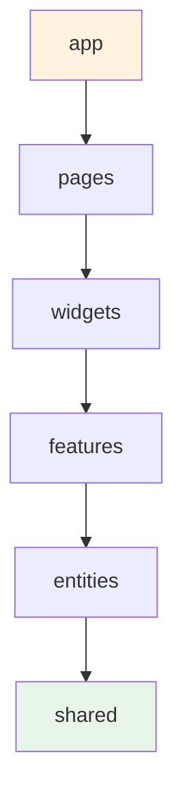
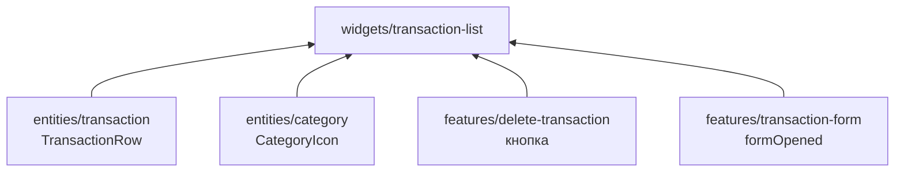

# 04. Feature-Sliced Design — с нуля

## Зачем

Новый проект начинается с папок `components/`, `hooks/`, `utils/`. Через полгода в
`components/` лежит 140 файлов, `utils.ts` разросся до 2000 строк, и на каждый вопрос «куда
положить этот файл?» в команде два разных ответа. Ещё хуже: поменяли кнопку — сломалась
корзина, потому что всё импортирует всё.

**FSD — это договорённость, куда класть код и кто кого может импортировать.** Документация
стандарта: [feature-sliced.design](https://feature-sliced.design).

## Аналогия: дом

```
app        крыша и фундамент    подключение электричества, воды (store, роутер)
pages      квартиры             «гостиная» — какая мебель где стоит
widgets    мебель               шкаф, кухонный гарнитур — собраны из деталей
features   действия             «открыть шкаф», «включить плиту»
entities   детали               дверца, полка, конфорка
shared     стройматериалы       шурупы, доски, краска — подходят к любому дому
```

**Главное правило:** этаж может использовать только то, что **ниже** него. Шкаф собирают из
досок, но доска ничего не знает про шкаф. Поэтому можно перекрасить шкаф, не трогая доски, а
если поменять доски — увидишь сразу, что затронет все шкафы.



## Три уровня: слой → слайс → сегмент

```
src/
├── features/                      ← СЛОЙ (этаж)
│   ├── transaction-form/          ← СЛАЙС (одна предметная область)
│   │   ├── model/                 ← СЕГМЕНТ (по назначению)
│   │   │   ├── schema.ts
│   │   │   └── form-slice.ts
│   │   ├── ui/                    ← СЕГМЕНТ
│   │   │   └── transaction-form.tsx
│   │   └── index.ts               ← ПУБЛИЧНЫЙ API (что видно снаружи)
│   └── delete-transaction/        ← другой слайс того же слоя
```

Сегменты называют **по назначению**:

| Сегмент | Что внутри |
| --- | --- |
| `ui` | компоненты |
| `model` | состояние: слайсы Redux, хуки с логикой, схемы |
| `api` | запросы к серверу (эндпоинты RTK Query) |
| `lib` | вспомогательные функции этого слайса |
| `config` | константы, настройки |

Не называйте сегменты по **виду** файлов: `components`, `hooks`, `types`, `utils`. Линтер
Steiger ругается на это ([урок 9](lessons.md)).

## Три правила импорта

**1. Только вниз.**

```ts
// features/transaction-form/ui/transaction-form.tsx
import { useCategoryMap } from '@/entities/category'     // ✓ features → entities
import { Button } from '@/shared/ui'                     // ✓ features → shared
import { TransactionList } from '@/widgets/transaction-list'  // ✗ features → widgets (вверх!)
```

**2. Соседи на одном этаже не видят друг друга.**

```ts
// entities/transaction/ui/transaction-row.tsx
import { CategoryIcon } from '@/entities/category'       // ✗ entities → entities
```

Как тогда показать иконку категории в строке операции? См. «Композиция наверху» ниже.

**3. Снаружи — только через `index.ts`.**

```ts
import { TransactionRow } from '@/entities/transaction'                       // ✓
import { TransactionRow } from '@/entities/transaction/ui/transaction-row'    // ✗ в обход
```

Зачем: `index.ts` — это витрина магазина. Внутри слайса можно переставлять файлы как угодно;
пока на витрине то же самое, снаружи никто не сломается.

## Куда положить файл: 12 примеров из «Сальдо»

| Что | Куда | Почему |
| --- | --- | --- |
| Кнопка, поле ввода, модалка | `shared/ui` | ничего не знают про финансы, подойдут любому проекту |
| `formatMoney`, `parseMoney` | `shared/lib` | общие функции без бизнес-смысла |
| Пустой `createApi`, типы ответов сервера | `shared/api` | основа для всех запросов |
| Демо-сервер MSW | `shared/mock` | замена бэкенда, а не часть приложения |
| Эндпоинты операций, строка операции | `entities/transaction` | «что такое операция» |
| Иконка категории, словарь категорий | `entities/category` | «что такое категория» |
| Расчёт темпа бюджета `budgetPace` | `entities/budget/lib` | правило предметной области «бюджет» |
| Форма «Новая операция» | `features/transaction-form` | действие пользователя |
| Удаление с отменой | `features/delete-transaction` | действие пользователя |
| Список операций по дням с кнопками | `widgets/transaction-list` | блок, собранный из сущностей и фич |
| Главная: месяц + шесть блоков | `pages/dashboard` | раскладка страницы |
| Store, роутер, глобальные стили | `app` | запуск приложения |

**Как отличить feature от entity:** entity — это **существительное** (операция, счёт,
категория), feature — **глагол с пользой для человека** (добавить операцию, удалить с
отменой, отфильтровать список). Кнопка «Удалить» — фича, строка операции — сущность.

## Композиция наверху

Как в строке операции показать иконку категории, название счёта и кнопки «изменить» и
«удалить», если сущность операции не может импортировать ни категорию, ни фичи?

**Ответ: строка получает всё это пропсами, а собирает её тот, кто выше.**

Сущность — «глупая» строка, всё снаружи
([entities/transaction/ui/transaction-row.tsx](../src/entities/transaction/ui/transaction-row.tsx)):

```tsx
interface TransactionRowProps {
  transaction: Transaction
  icon: ReactNode          // иконку передаст тот, кто знает про категории
  category?: Category
  account?: Account
  actions?: ReactNode      // кнопки передаст тот, кто знает про фичи
  onOpen?: () => void
}
```

Виджет собирает её из частей
([widgets/transaction-list/ui/transaction-groups.tsx](../src/widgets/transaction-list/ui/transaction-groups.tsx)):

```tsx
import { CategoryIcon, useCategoryMap } from '@/entities/category'        // сущность
import { TransactionRow } from '@/entities/transaction'                   // сущность
import { DeleteTransactionButton } from '@/features/delete-transaction'   // фича
import { formOpened } from '@/features/transaction-form'                  // фича

<TransactionRow
  transaction={t}
  icon={<CategoryIcon category={categories.get(t.categoryId)} />}
  category={categories.get(t.categoryId)}
  account={account(t.accountId)}
  onOpen={() => dispatch(formOpened({ editing: t }))}
  actions={<DeleteTransactionButton transaction={t} />}
/>
```



Это самый частый приём FSD: **нижние слои дают детали, верхние собирают**.

## Спорные места и как они решены

**Типы ответов сервера лежат в `shared`, а не в сущностях.** Их используют и сущности, и
демо-сервер в `shared/mock`. Сервер не может импортировать из `entities` (это вверх), значит,
типы — внизу. В проекте с настоящим бэкендом так же лежали бы типы, сгенерированные из
OpenAPI.

**`RootState` — глобальный тип.** Хукам в `shared` нужен тип всего состояния, а он
собирается в `app`. Решение — `declare global` (глава 02).

**Форма — одна на всё приложение.** Её открывают с кнопки «+», клавишей N, кликом по строке.
Модалка смонтирована один раз в каркасе (`widgets/app-shell`), а открывается экшеном
`formOpened`. Иначе пришлось бы ставить по модалке в каждый виджет.

**Эндпоинт сброса демо — в фиче, а не в сущности.** Он нужен только кнопке «Сбросить демо»,
поэтому `features/reset-demo/api/reset-api.ts` сам делает `injectEndpoints`.

## Steiger — линтер архитектуры

```bash
npx steiger ./src
```

Проверяет правила этой главы: импорты только вниз, без обхода `index.ts`, имена сегментов
по назначению. Запускается в `npm run lint` и в CI, поэтому нарушение не попадёт в `main`.

Одно правило выключено — `fsd/insignificant-slice`: «слайс используется в одном месте —
объедините». Для приложения такого размера совет верный: график доходов нужен только на
главной и мог бы жить в `pages/dashboard`. Но проект учебный: границы проведены нарочно,
чтобы показать структуру, которая выдержит рост.

## Когда FSD не нужен

Лендинг, прототип на неделю, приложение на пять экранов — хватит `components/` и `pages/`.
FSD окупается, когда над кодом работают несколько человек и он живёт годами.

## Попробуйте сами

1. Нужен компонент `Money` — сумма с цветом и неразрывными пробелами. Какой слой?
2. Нужна кнопка «Дублировать операцию». Какой слой и какой слайс?
3. Можно ли в `entities/budget` импортировать `formatMoney` из `@/shared/lib`? А
   `useCategoryMap` из `@/entities/category`?
4. Где должна лечь страница «Цели накоплений» с прогрессом по каждой цели?
5. Запустите `npx steiger ./src`, затем добавьте в любой файл `entities/budget` строку
   `import { CategoryIcon } from '@/entities/category'` и запустите снова. Что скажет линтер?

<details>
<summary>Ответы</summary>

1. `shared/ui` — ничего не знает про финансы (так и сделано: `shared/ui/money.tsx`).
2. `features/duplicate-transaction`: действие с пользой. Внутри — `ui/duplicate-button.tsx` и
   вызов `useCreateTransactionMutation` из `@/entities/transaction`.
3. `formatMoney` — да (вниз, в `shared`). `useCategoryMap` — нет: соседний слайс того же слоя.
   Если бюджету нужна категория, передайте её пропсом из виджета.
4. Сущность `entities/goal` (эндпоинты, «глупая» карточка цели) → виджет
   `widgets/goal-list` → страница `pages/goals`. Действия «создать цель» и «пополнить» — фичи.
5. Ошибку `fsd/forbidden-imports`: кросс-импорт между слайсами одного слоя.
</details>
