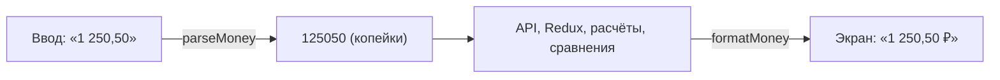

# 06. Деньги и даты — с нуля

## Деньги: почему копейки

Откройте консоль браузера и выполните:

```js
0.1 + 0.2          // 0.30000000000000004
1.15 * 100         // 114.99999999999999
19.99 * 3          // 59.97000000000001
```

Это не ошибка JavaScript: так работают все числа с плавающей точкой (стандарт IEEE 754). Компьютер
хранит дроби в двоичной системе, а 0,1 в двоичной системе — бесконечная дробь, как 1/3 в
десятичной (0,3333…). Её приходится обрезать, и появляется крошечная погрешность.

Для одной суммы это незаметно. Но сложите тысячу операций, и итог разойдётся с суммой строк
на копейку-другую. В финансовом приложении такое недопустимо.

**Решение: хранить целые копейки.** Целые числа складываются точно.

```js
10 + 20            // 30 — копейки: 0,10 ₽ + 0,20 ₽ = 0,30 ₽ точно
115                // 1,15 ₽ — никаких 114.999
```

### Правило «Сальдо»



Копейки везде, кроме двух мест: **ввода** (строка пользователя → копейки) и **вывода**
(копейки → строка для экрана).

### parseMoney — [shared/lib/money.ts](../src/shared/lib/money.ts)

```ts
parseMoney('1234')        // 123400
parseMoney('1 234,5')     // 123450
parseMoney('−200')        // -20000 (настоящий минус тоже понимает)
parseMoney('1 200 ₽')     // 120000
parseMoney('2,000.00')    // 200000 — английский формат из выписок
parseMoney('abc')         // null — «это не сумма»
```

Главный приём — **не умножать дробь на 100**, а разобрать строку на части:

```ts
// ✗ Number('1.15') * 100  → 114.99999999999999
// ✓ '1.15' → целая часть '1', дробная '15' → 1 * 100 + 15 = 115
const [whole = '0', frac = ''] = s.split('.')
const kopecks = Number(whole) * 100 + Number((frac + '00').slice(0, 2))
```

`(frac + '00').slice(0, 2)` превращает `'5'` в `'50'`, `''` в `'00'`, `'15'` в `'15'`.

### formatMoney — Intl.NumberFormat

Браузер умеет форматировать деньги сам, на любом языке:

```ts
new Intl.NumberFormat('ru-RU', { style: 'currency', currency: 'RUB' }).format(1250.5)
// «1 250,50 ₽»
```

В «Сальдо» — обёртка с опциями:

```ts
formatMoney(125050)                    // «1 250,50 ₽»
formatMoney(120000, { trim: true })    // «1 200 ₽» — без нулевых копеек
formatMoney(5000, { sign: true })      // «+50,00 ₽» — для доходов
formatMoney(-500)                      // «−5,00 ₽» — настоящий минус, а не дефис
formatAxis(12_000_000)                 // «120к» — для подписей графиков
```

Пробелы в результате **неразрывные** (U+00A0): «1 250 ₽» никогда не разорвётся переносом
между «1» и «250».

## Даты: почему строки, а не Date

Выполните в консоли (у вас Москва, UTC+3):

```js
new Date('2026-10-01')                 // Thu Oct 01 2026 03:00:00 GMT+0300 — уже 3 часа ночи
new Date('2026-10-01').toISOString()   // '2026-10-01T00:00:00.000Z' — полночь по Гринвичу
```

`new Date('2026-10-01')` — это **полночь по Гринвичу**. В Нью-Йорке в этот момент ещё
**30 сентября**. Если человек из Нью-Йорка купит хлеб 1 октября, его операция может
оказаться в сентябре.

Для операции «купил хлеб 1 октября» время не нужно вообще. Поэтому дата операции — **строка**
`'2026-10-01'` без времени и часового пояса.

```ts
'2026-09-30' < '2026-10-01'            // true — строки сравниваются как надо
'2026-10-14'.slice(0, 7)               // '2026-10' — месяц
```

Это работает, потому что формат «год-месяц-день» с ведущими нулями упорядочен так же, как
сами даты.

### «Сегодня» — по местному времени

```ts
new Date().toISOString().slice(0, 10)  // ✗ UTC: в Москве с 00:00 до 03:00 это ещё «вчера»
toISODate(new Date())                  // ✓ getFullYear/getMonth/getDate — местная дата
```

Эта ошибка попала в проект ([урок 4](lessons.md)) и была поймана.

### Месяцы в падежах

date-fns знает именительный падеж («октябрь») и родительный («14 октября»). Для подписи
«▼ 22 % к сентябрю» нужен **дательный** — его [formatMonth](../src/shared/lib/date.ts) строит сам:

```ts
formatMonth('2026-09', 'dative')   // «сентябрю»  (ь → ю)
formatMonth('2026-05', 'dative')   // «маю»       (й → ю)
formatMonth('2026-03', 'dative')   // «марту»     (+ у)
```

## Попробуйте сами

1. Чему равно `parseMoney('0,05')`? А `parseMoney('0,005')`?
2. Почему `formatMoney(-500)` заменяет дефис на «−»?
3. Тест `money.test.ts` проверяет, что в `formatMoney(100000)` нет обычных пробелов. Зачем?

<details>
<summary>Ответы</summary>

1. `5` копеек. `'0,005'` → дробная часть `'005'`, берутся первые две цифры `'00'` → `0`:
   доли копейки отбрасываются.
2. Минус «−» (U+2212) — типографский знак, по ширине такой же, как цифры и «+». Дефис короче, и
   колонки сумм «пляшут».
3. Чтобы «1 000 ₽» не разорвалось переносом строки посередине суммы.
</details>
