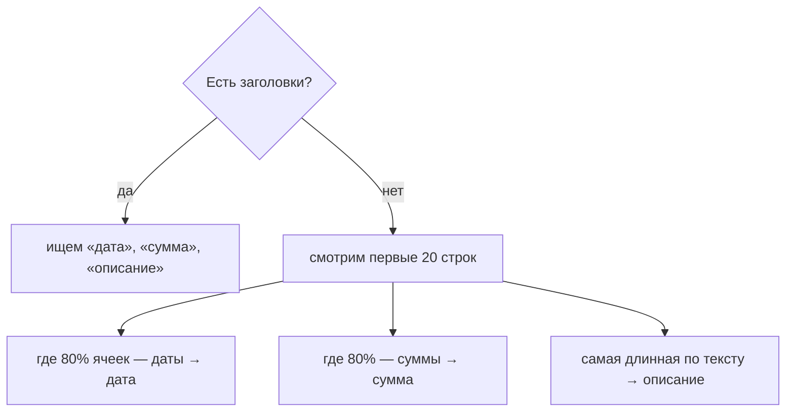

# 08. Импорт выписки — с нуля

Интернет-банк умеет выгружать операции в CSV — таблицу, где строки разделены переносом, а
колонки — `;` или `,`:

```
Дата операции;Статус;Сумма операции;Валюта;Описание
13.10.2026 10:07;OK;-486,90;RUB;ПЯТЕРОЧКА 4512 МОСКВА
13.10.2026 10:07;OK;-189,00;RUB;COFFEE LIKE
07.10.2026 16:49;OK;12 000,00;RUB;Перевод от ИП Смирнов за лендинг
```

Задача: превратить это в операции «Сальдо». Сложность в том, что у каждого банка свой формат.

## Шаг 1. Кодировка

Файл — это байты. Чтобы получить текст, нужно знать кодировку. Российские банки отдают
**UTF-8** или старую **Windows-1251**. Если прочитать 1251 как UTF-8, получится «кракозябра»
и символ-заменитель `�` (U+FFFD).

```ts
export function decode(buffer: ArrayBuffer): string {
  const utf8 = new TextDecoder('utf-8').decode(buffer)
  if (!utf8.includes('�')) return utf8          // прочиталось чисто — это UTF-8
  return new TextDecoder('windows-1251').decode(buffer)  // иначе пробуем 1251
}
```

`TextDecoder` встроен в браузер, библиотеки не нужны.

## Шаг 2. Таблица

Разрезать по `;` нельзя: в описании бывает `"ООО ""Ромашка""; Москва"` — точка с запятой
внутри кавычек. Это делает Papa Parse, он же угадывает разделитель:

```ts
Papa.parse('a;b\n1;"x; y"').data   // [['a', 'b'], ['1', 'x; y']]
```

## Шаг 3. Какая колонка за что

Сначала по заголовкам: колонка, где в названии есть «дата», — это дата. Если заголовков нет,
то по содержимому:



Угадали неверно — пользователь поправит на шаге «Колонки».

## Шаг 4. Даты и суммы

```ts
parseDate('14.10.2026')            // '2026-10-14'
parseDate('14/10/26')              // '2026-10-14'
parseDate('2026-10-14 12:30')      // '2026-10-14'
parseDate('31.02.2026')            // null — такого дня нет
```

Последняя строка — ловушка: `new Date(2026, 1, 31)` **не ругается**, а молча даёт 3 марта.
Поэтому после создания даты проверяем, что день остался тем же.

Ошибки разбора не бросают исключение, а записываются в строку: `{ line: 18, error: 'Не понял
дату «вчера»' }`. Одна кривая строка не роняет весь файл.

## Шаг 5. Категории

Простые правила по ключевым словам:

```ts
[/пят[её]рочк|перекр[её]ст|магнит|вкусвилл/i, 'groceries'],
[/кофе|cafe|кафе|ресторан|пицц|суши/i, 'cafe'],
[/метро|такси|каршеринг/i, 'transport'],
```

Не угадали — строка помечается «Без категории» и не импортируется, пока человек не выберет.

## Шаг 6. Мастер на Redux

Состояние мастера ([import-slice.ts](../src/features/import-statement/model/import-slice.ts)):

```ts
{
  step: 'review',                         // где мы: upload → map → review → done
  table: [['Дата', …], ['13.10.2026', …]], // таблица из файла
  hasHeader: true,
  mapping: { date: 0, amount: 2, description: 4 },
  accountId: 'card',
  overrides: { 11: { categoryId: 'transport' } },  // правки по номеру строки
}
```

Готовые строки здесь **не хранятся** — их вычисляют селекторы (глава 02, «createSelector»).

## Шаг 7. Дубликаты

Человек импортировал выписку за октябрь, а через неделю — снова за октябрь с новыми днями.
Старые операции не должны задвоиться. Сервер считает дубликатом операцию с той же датой,
суммой, типом, счётом и описанием:

```ts
const key = (t) => [t.date, t.amount, t.type, t.accountId, t.note.toLowerCase()].join('|')
// '2026-10-13|48690|expense|card|пятерочка 4512 москва'
```

Результат: «Добавлено операций: 3. Пропущено как дубликаты: 14».

## Попробуйте сами

Нажмите «Попробовать на примере», дойдите до проверки и:

1. Выберите категорию для строки «Самокат». Как изменилась кнопка «Импортировать N операций»?
2. Вернитесь на «Колонки» и назначьте «Описание» на колонку «Статус». Что стало со строками?
3. Импортируйте, затем сразу импортируйте тот же пример ещё раз. Что ответит мастер?

<details>
<summary>Ответы</summary>

1. N увеличилось на 1: строка стала полной и попала в план импорта.
2. Описание у всех строк стало «OK», категории не угадываются, и почти всё ушло в «Без
   категории». Правки по строкам сбросились, потому что строки стали другими.
3. «Добавлено операций: 0, пропущено как дубликаты: 14».
</details>
