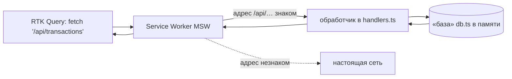

# 09. Демо-сервер — с нуля

## Проблема

На GitHub Pages можно выложить только файлы: HTML, JS, картинки. Сервера с базой данных там
нет. А приложению нужен API: `GET /api/transactions`, `POST /api/transactions`…

## Решение: Mock Service Worker

**Service Worker** — скрипт, который браузер ставит **между страницей и сетью**. Он видит
каждый запрос страницы и может ответить сам, не ходя в интернет. Обычно так делают
офлайн-режим сайтов.

**MSW** использует это для подделки сервера:



Приложение делает **обычный** `fetch`. В DevTools → Network запрос виден как настоящий. Ни
RTK Query, ни компоненты не знают, что сервера нет.

## Самый маленький пример

```ts
import { http, HttpResponse } from 'msw'
import { setupWorker } from 'msw/browser'

const todos = [{ id: 1, title: 'Купить молоко' }]

const worker = setupWorker(
  http.get('/api/todos', () => HttpResponse.json(todos)),
  http.post('/api/todos', async ({ request }) => {
    const body = await request.json()
    const todo = { id: Date.now(), ...body }
    todos.push(todo)
    return HttpResponse.json(todo, { status: 201 })
  }),
)
await worker.start()   // после этого fetch('/api/todos') отвечает отсюда
```

## Как устроено в «Сальдо» — [shared/mock](../src/shared/mock/)

| Файл | Роль | Аналог на настоящем бэкенде |
| --- | --- | --- |
| `seed.ts` | 13 месяцев правдоподобных операций | заполнение базы для разработки |
| `db.ts` | фильтры, страницы, итоги, проверки, остатки | SQL-запросы и бизнес-логика |
| `handlers.ts` | разобрать запрос, вызвать db, вернуть код ответа | контроллеры / роуты |
| `browser.ts` | запуск в браузере + сохранение в localStorage | — |
| `node.ts` | тот же сервер для тестов | — |

Данные сохраняются в localStorage: добавили операцию, закрыли вкладку — она осталась.
Сбросить можно кнопкой «Сбросить демо».

### Генератор с зерном

`Math.random()` каждый раз даёт разное. Демо-данные «прыгали» бы при каждом сбросе, а тесты
нельзя было бы написать. Поэтому генератор **с зерном** (seed): одно и то же зерно → одна и
та же последовательность «случайных» чисел.

```ts
const rng = createRng(20261014)
rng.int(1, 10)   // всегда 2 при этом зерне
rng.int(1, 10)   // всегда 9
```

## Пульт в консоли

Откройте демо → DevTools → Console:

```js
__saldo.controls.fail = true      // все запросы отвечают 503 — экраны ошибок
__saldo.controls.latency = 3000   // медленная сеть 3 секунды — видно скелетоны
__saldo.controls.latency = null   // обратно: 120–450 мс, «как в жизни»
__saldo.db.transactions({ q: 'кофе' }).total   // заглянуть в «базу» напрямую
```

## Отдельный файл в сборке

MSW с зависимостями весит ~150 КБ gzip — больше всего приложения. Поэтому он грузится
динамическим `import()`:

```ts
const { startMockServer } = await import('@/shared/mock')
await startMockServer()
```

Сборщик кладёт его в отдельный файл. С настоящим бэкендом эти две строки удаляются, и файл
не скачивается вовсе.

## Как подключить настоящий бэкенд

1. В [shared/config](../src/shared/config/index.ts) поменять `API_URL` на адрес сервера.
2. Убрать запуск MSW из `app/entrypoint/main.tsx`.
3. Бэкенд должен отвечать по контракту из [shared/api/types.ts](../src/shared/api/types.ts).

Код компонентов, RTK Query и тестов не меняется.
