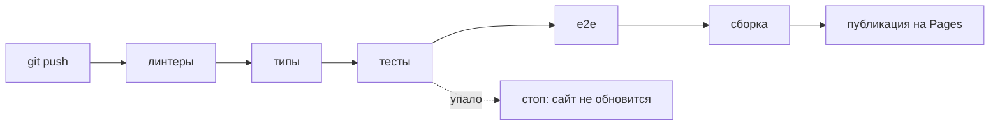

# 10. Тесты и публикация — с нуля

## Зачем тесты

Тест — это маленькая программа, которая проверяет вашу программу. Вы меняете код, запускаете
`npm test` и за секунды узнаёте, не сломалось ли то, что работало вчера. Без тестов это
выясняет пользователь.

## Пирамида: много маленьких, мало больших

```
              ╱╲            E2E (Playwright): настоящий браузер, 7 сценариев.
             ╱  ╲           Медленно, но проверяет «как у пользователя».
            ╱────╲
           ╱      ╲         Интеграция: store + RTK Query + MSW, форма в jsdom.
          ╱        ╲        Проверяют, что части работают вместе.
         ╱──────────╲
        ╱            ╲      Чистые функции: деньги, даты, разбор CSV, бюджет.
       ╱              ╲     Мгновенно, их больше всего.
      ╱────────────────╲
```

```bash
npm test                 # Vitest: всё, кроме браузера (~3 секунды)
npm run e2e              # Playwright: собрать, открыть в Chrome, пройти сценарии
npm run check:mobile     # все страницы на ширине 320–414 px: ничего не вылезает?
npm run check            # линтеры + типы + тесты + сборка — то же, что в CI
```

## Уровень 1: чистые функции

Самые простые тесты: дали вход — проверили выход ([money.test.ts](../src/shared/lib/money.test.ts)):

```ts
import { describe, expect, it } from 'vitest'
import { parseMoney } from './money'

describe('parseMoney', () => {
  it('понимает запятую и пробелы', () => {
    expect(parseMoney('1 234,5')).toBe(123450)
  })

  it.each([
    ['1.15', 115],          // ловушка плавающей точки
    ['2,000.00', 200000],   // английский формат
  ])('«%s» → %i', (input, expected) => {
    expect(parseMoney(input)).toBe(expected)
  })
})
```

- `describe` — группа, `it` — один случай;
- `expect(x).toBe(y)` — «x должен быть равен y»;
- `it.each` — один тест на много входов (таблица).

## Уровень 2: RTK Query + MSW — без моков fetch

Частая ошибка — подменять `fetch` руками (`vi.mock`). Тогда тест проверяет вашу подделку, а
не код. В «Сальдо» в тестах работает **тот же** демо-сервер, только в Node
([test/utils.tsx](../test/utils.tsx)):

```ts
const ctx = setupApi()                      // MSW в Node + свежая «база» на файл тестов

it('создание обновляет список', async () => {
  const store = makeStore()                 // настоящий store приложения

  // Подписаться на список — как будто компонент на экране.
  const sub = store.dispatch(transactionApi.endpoints.getTransactions.initiate(query))
  await sub
  const before = selectList(store.getState()).total

  // Создать операцию.
  await store.dispatch(transactionApi.endpoints.createTransaction.initiate(input)).unwrap()
  await settle(store)                       // дождаться перезапросов после инвалидации

  expect(selectList(store.getState()).total).toBe(before + 1)
})
```

Ответ сервера для одного теста подменяется так:

```ts
ctx.server.use(
  http.patch(`${API_URL}/transactions/:id`, () =>
    HttpResponse.json({ fields: { note: 'Нельзя' } }, { status: 422 })),
)
```

## Уровень 2½: время — фейковые таймеры

Удаление ждёт 5 секунд. Тест не должен ждать по-настоящему. Vitest умеет «перематывать время»:

```ts
vi.useFakeTimers({ shouldAdvanceTime: true })

store.dispatch(deleteRequested(transaction))
await vi.advanceTimersByTimeAsync(4900)      // прошло 4,9 с — ещё не удалено
expect(() => db.transaction(id)).not.toThrow()

await vi.advanceTimersByTimeAsync(200)       // прошло 5,1 с — удалено
await vi.waitFor(() => expect(() => db.transaction(id)).toThrow())
```

Тест идёт миллисекунды. `shouldAdvanceTime` нужен, чтобы промисы MSW и fetch продолжали работать.

## Уровень 2¾: компонент — Testing Library

Тестируем форму **как пользователь**: находим поле по подписи, печатаем, жмём кнопку
([transaction-form.test.tsx](../src/features/transaction-form/ui/transaction-form.test.tsx)):

```ts
await userEvent.type(screen.getByLabelText('Сумма'), '1 250,5')
await userEvent.click(screen.getByRole('radio', { name: 'Кафе и рестораны' }))
await userEvent.click(screen.getByRole('button', { name: 'Добавить' }))

expect(db.transactions({ q: 'Ужин' }).items[0]).toMatchObject({ amount: 125050 })
```

Поиск по **подписи и роли**, а не по классам: тест заодно проверяет доступность. Если у поля
нет подписи, `getByLabelText` его не найдёт.

## Уровень 3: E2E — Playwright

Настоящий Chrome открывает собранный сайт ([e2e/app.spec.ts](../e2e/app.spec.ts)):

```ts
test('новая операция по клавише N', async ({ page }) => {
  await page.goto('/transactions')
  await page.keyboard.press('n')
  const dialog = page.getByRole('dialog', { name: 'Новая операция' })
  await dialog.getByLabel('Сумма').fill('321,5')
  await dialog.locator('label', { hasText: 'Подарки' }).click()
  await dialog.getByRole('button', { name: 'Добавить' }).click()
  await expect(page.getByText('Добавлено: 321,50 ₽')).toBeVisible()
})
```

Два проекта: компьютер и телефон (Pixel 7). На телефоне проверяется, что ни на одной странице
нет прокрутки вбок и что нижнее меню прячется при прокрутке.

## CI: проверка на каждый push

[.github/workflows/pages.yml](../.github/workflows/pages.yml) — инструкция для GitHub:



Сломанный код не попадёт на сайт: любой красный шаг останавливает публикацию.

## GitHub Pages: три тонкости

1. **Подпапка.** Сайт живёт по адресу `/saldo/`, а не `/`. Поэтому `base` в Vite и `basename`
   в роутере берутся из переменной `VITE_BASE`.
2. **Обновление на внутренней странице.** Откройте `/saldo/transactions` и нажмите F5. GitHub
   Pages ищет файл `transactions` — его нет — и отдаёт `404.html`. А `404.html` — это **копия**
   `index.html`, то есть то же приложение. Роутер видит адрес и показывает нужную страницу.
3. **Service Worker** тоже лежит в подпапке: `${BASE_URL}mockServiceWorker.js`.
