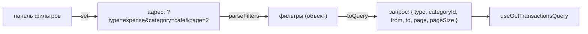

# 7. Фильтры в адресе

Папка [features/filter-transactions](../../src/features/filter-transactions/):

| Файл | Что делает |
| --- | --- |
| `model/use-filters.ts` | хук: адрес страницы ↔ фильтры ↔ запрос к серверу |
| `ui/transaction-filters.tsx` | панель: поиск, тип, период, месяц, счёт, категория, сортировка |

## Где на экране

Страница «Операции», над списком. Попробуйте: выберите «Расходы» и категорию «Кафе», и
посмотрите на адрес — `/transactions?type=expense&category=cafe`. Скопируйте ссылку в другую
вкладку: фильтры на месте. Нажмите «Назад» в браузере — вернётся прошлый фильтр.

## Главная идея: адрес — единственный источник правды



Фильтры **не хранятся** ни в `useState`, ни в Redux. Панель меняет адрес, адрес превращается
в фильтры, фильтры — в запрос. Поэтому всё само синхронизировано: кнопка «Назад», ссылка от
коллеги, клик по категории на главной (`/transactions?category=cafe&month=2026-09`).

---

## Хук useTransactionFilters

### Часть 1. Адрес → фильтры

```ts
export function parseFilters(params: URLSearchParams): Filters {
  const period = params.get('period') as Period
  const type = params.get('type') as TransactionType
  const page = Number(params.get('page'))
  return {
    period: PERIODS.includes(period) ? period : 'month',
    type: TYPES.includes(type) ? type : undefined,
    page: Number.isInteger(page) && page > 0 ? page : 1,
    // …
  }
}
```

Адрес может прислать кто угодно, в том числе с мусором: `?page=abc&type=gift`. Каждое значение
проверяется, при ошибке берётся значение по умолчанию. Страница не падает, тест на это есть:
`use-filters.test.ts`, «мусор в адресе не ломает страницу».

`params.get('type')` возвращает строку или `null`, если параметра нет.

### Часть 2. Фильтры → запрос

```ts
export function toQuery(f: Filters): TransactionQuery {
  const range =
    f.period === 'month' ? monthRange(f.month)                         // 1-е … 31-е число
    : f.period === '3m' ? { from: monthRange(shiftMonth(f.month, -2)).from, to: today() }
    : f.period === 'year' ? { from: monthRange(shiftMonth(currentMonth(), -11)).from, to: today() }
    : {}                                                               // «всё время» — без границ
  return { ...range, type: f.type, categoryId: f.categoryId, q: f.q.trim() || undefined, page: f.page, pageSize: PAGE_SIZE }
}
```

Человеку удобно выбрать «Месяц: сентябрь», а серверу нужны даты `from=2026-09-01&to=2026-09-30`.
`toQuery` переводит одно в другое. Это чистая функция, её легко проверить тестом.

### Часть 3. Изменить фильтры

```ts
function set(patch: Partial<Filters>, { replace = false } = {}) {
  setParams((prev) => {
    const next = new URLSearchParams(prev)                    // ① копия текущего адреса
    for (const [key, value] of Object.entries(patch)) {
      const text = value === undefined ? '' : String(value)
      if (!text || text === DEFAULTS[key]) next.delete(PARAM[key])   // ② по умолчанию — убрать
      else next.set(PARAM[key], text)                                // ③ иначе — записать
    }
    if (!('page' in patch)) next.delete('page')               // ④ сменили фильтр — на 1-ю страницу
    return next
  }, { replace })                                             // ⑤
}
```

- ① `setParams` с функцией получает текущие параметры. Меняем только переданное, остальное не трогаем.
- ② Значения по умолчанию в адрес не пишем: чистая страница — это `/transactions`, а не
  `/transactions?period=month&sort=date&dir=desc&page=1`.
- ③ Имена в адресе короче имён в коде: `accountId` → `account`. Соответствие задаёт `PARAM`.
- ④ Были на странице 5, поменяли тип — на новой выборке может не быть пятой страницы.
  Любой фильтр, кроме самой страницы, сбрасывает на первую.
- ⑤ `replace: true` — заменить текущую запись истории, а не добавить новую (подробнее ниже).

Использование:

```tsx
const { filters, query, set, reset, active } = useTransactionFilters()

set({ type: 'expense' })                // ?type=expense
set({ categoryId: undefined })          // убрать категорию
set({ page: 3 })                        // ?…&page=3
reset()                                 // /transactions
```

---

## Панель TransactionFilters — поиск «по мере ввода»

Самая хитрая часть — поле поиска. Требования:

1. Поле реагирует на каждую букву **мгновенно**.
2. Запрос к серверу уходит **не на каждую букву**, а через 300 мс после последней. Иначе
   «пятёрочка» — это 9 запросов.
3. Каждая буква **не** должна становиться шагом истории, иначе «Назад» будет стирать по букве.
4. Если адрес поменялся **снаружи** (кнопка «Сбросить», «Назад»), поле должно это показать.

### Код

```tsx
  const [search, setSearch] = useState(filters.q)                   // ① что в поле сейчас
  const timer = useRef<ReturnType<typeof setTimeout>>(undefined)    // ② отложенная запись
  const written = useRef(filters.q)                                 // ③ что мы сами записали
```

- ① Своё состояние у поля: адрес обновляется с задержкой, а поле — сразу (требование 1).
- ② Номер таймера. `useRef`, потому что рисовать его не нужно, а помнить между
  перерисовками — нужно.
- ③ Что **мы** последним записали в адрес. Нужно, чтобы отличить своё изменение от чужого (требование 4).

```tsx
  function onSearch(value: string) {
    setSearch(value)                                 // поле — сразу
    clearTimeout(timer.current)                      // прошлую отложенную запись — отменить
    timer.current = setTimeout(() => {
      written.current = value
      set({ q: value }, { replace: true })           // адрес — через 300 мс, без шага истории
    }, 300)
  }
```

Это **debounce** («подавление дребезга»): пока человек печатает, каждая буква отменяет
предыдущий таймер. Запись срабатывает, только когда он остановился на 300 мс.

```
п      → таймер на 300 мс
пя     → отменили, новый таймер
пят    → отменили, новый таймер
…
пятёрочка  → отменили, новый таймер
(пауза 300 мс) → адрес ?q=пятёрочка → один запрос к серверу
```

```tsx
  useEffect(() => () => clearTimeout(timer.current), [])
```

Эффект без тела, только с очисткой: компонент исчез — отменить незаписанный поиск. Иначе
через 300 мс после ухода со страницы адрес вдруг поменялся бы.

```tsx
  useEffect(() => {
    if (filters.q === written.current) return        // это мы сами записали — ничего не делать
    written.current = filters.q
    clearTimeout(timer.current)
    setSearch(filters.q)                             // адрес поменяли снаружи — поле следует
  }, [filters.q])
```

Нажали «Сбросить» → адрес `/transactions` → `filters.q = ''`. Это не то, что мы записывали,
значит, изменение снаружи: очищаем поле. Без проверки `written` эффект срабатывал бы и на
наши собственные записи и мог бы стереть буквы, напечатанные за эти 300 мс.

## Почему не useDebounce + useEffect

Первая версия была такой:

```tsx
const debounced = useDebouncedValue(search, 300)
useEffect(() => { set({ q: debounced }) }, [debounced])      // адрес ← поле
useEffect(() => { setSearch(filters.q) }, [filters.q])       // поле ← адрес
```

Два эффекта тянут в разные стороны. Нажали «Сбросить» → адрес пустой → второй эффект
очистил поле… но `debounced` ещё 300 мс помнит старое значение, первый эффект записывает его
обратно в адрес. Фильтр «воскресает». Вывод: если состояние живёт в двух местах, явно решите,
кто главный, и не синхронизируйте эффектами в обе стороны.

## Проверьте себя

1. Почему у страницы в адресе нет `?page=1`, когда вы на первой странице?
2. Напечатайте в поиске «кофе» и нажмите «Назад» в браузере. Куда вы попадёте и почему?
3. Что будет, если убрать `if (!('page' in patch)) next.delete('page')`?

<details>
<summary>Ответы</summary>

1. `1` — значение по умолчанию (`DEFAULTS.page`), такие значения в адрес не пишутся.
2. На страницу, с которой пришли на «Операции». Поиск пишется с `replace: true` и не создаёт
   шагов истории.
3. Были на странице 4 «всех операций», выбрали категорию «Кино», где всего 3 операции, — и
   видите пустую четвёртую страницу.
</details>
