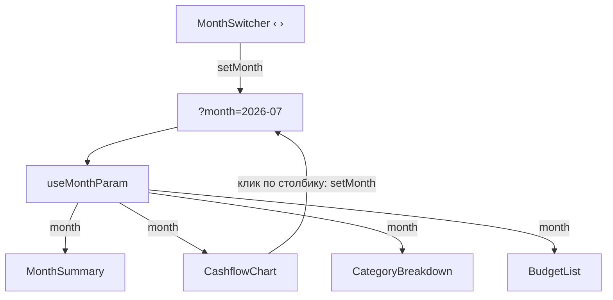

# 9. Виджеты главной

| Файл | Что это на экране |
| --- | --- |
| [dashboard-page.tsx](../../src/pages/dashboard/ui/dashboard-page.tsx) | страница «Обзор»: месяц + шесть блоков |
| [use-month-param.ts](../../src/shared/lib/use-month-param.ts) | выбранный месяц в адресе |
| [month-switcher.tsx](../../src/shared/ui/month-switcher.tsx) | «‹ Октябрь 2026 ›» |
| [month-summary.tsx](../../src/widgets/month-summary/ui/month-summary.tsx) | четыре карточки сверху |
| [cashflow-chart.tsx](../../src/widgets/cashflow-chart/ui/cashflow-chart.tsx) | столбики «Доходы и расходы» за год |
| [category-breakdown.tsx](../../src/widgets/category-breakdown/ui/category-breakdown.tsx) | «бублик» расходов по категориям |

## Страница: один месяц на всех

```tsx
export function DashboardPage() {
  const [month, setMonth] = useMonthParam()
  return (
    <>
      <PageHeader title="Обзор" actions={<MonthSwitcher value={month} onChange={setMonth} />} />
      <div className={s.grid}>
        <div className={s.wide}><MonthSummary month={month} /></div>
        <CashflowChart month={month} onSelect={setMonth} end={currentMonth()} />
        <CategoryBreakdown month={month} />
        <BudgetList month={month} compact />
        <RecentTransactions />
      </div>
    </>
  )
}
```

Месяц — **одно** значение на всю страницу, и меняют его двое: стрелки `MonthSwitcher` и клик по
столбику графика (`onSelect={setMonth}`). Все виджеты получают его пропсом и сами загружают
свои данные.



## useMonthParam — месяц в адресе

```ts
export function useMonthParam(): [MonthKey, (month: MonthKey) => void] {
  const [params, setParams] = useSearchParams()
  const raw = params.get('month') ?? ''
  const month = /^\d{4}-\d{2}$/.test(raw) && raw <= currentMonth() ? raw : currentMonth()
```

Хук возвращает пару `[значение, сеттер]` — точно как `useState`, только хранится всё в адресе.
Поэтому снаружи он и выглядит как `useState`: `const [month, setMonth] = useMonthParam()`.

Проверка значения: формат `ГГГГ-ММ` и не в будущем. `?month=привет` или `?month=2099-01` —
показываем текущий месяц.

```ts
  const setMonth = (next: MonthKey) =>
    setParams((prev) => {
      const p = new URLSearchParams(prev)
      if (next === currentMonth()) p.delete('month')    // текущий месяц — чистый адрес
      else p.set('month', next)
      return p
    }, { replace: true })                               // листание месяцев — без шагов истории
```

## MonthSwitcher — «‹ Октябрь 2026 ›»

```tsx
export function MonthSwitcher({ value, onChange }) {
  const isCurrent = value >= currentMonth()
  return (
    <div className={s.root}>
      <button onClick={() => onChange(shiftMonth(value, -1))} aria-label="Предыдущий месяц"><ChevronLeft /></button>
      <span aria-live="polite">{formatMonth(value)}</span>
      <button onClick={() => onChange(shiftMonth(value, 1))} disabled={isCurrent} aria-label="Следующий месяц"><ChevronRight /></button>
    </div>
  )
}
```

- Компонент **управляемый**: месяц хранит не он, а тот, кто его использует.
- `shiftMonth('2026-01', -1)` → `'2025-12'`: переход через год считает date-fns.
- Вперёд текущего месяца листать нельзя: там нет операций.
- `aria-live="polite"` — скринридер прочитает новый месяц после нажатия на стрелку.

## MonthSummary — четыре карточки

```tsx
export function MonthSummary({ month }) {
  const summary = useGetMonthSummaryQuery(month)        // доходы, расходы, прошлый месяц
  const accounts = useGetAccountsQuery()                // остатки счетов
```

Два независимых запроса. Каждая карточка показывает скелетон, пока **её** данных нет.

```tsx
  const total = accounts.data?.reduce((sum, a) => sum + a.balance, 0)
  const saved = data ? data.income - data.expense : 0
  const rate = data && data.income > 0 ? saved / data.income : null
```

- `reduce` — сложить остатки всех счетов. `?.` — пока счета не загрузились, `total` будет `undefined`.
- `rate` — какая доля дохода отложена. Если доходов не было, делить на ноль нельзя, поэтому `null`.

```tsx
  <Stat label="Доходы" icon={<ArrowDownRight />} tone="income" value={data?.income}
        hint={data && <Change current={data.income} previous={data.previous.income} goodWhenUp month={prev} />} />
```

`Stat` — маленький компонент внутри того же файла: иконка, подпись, сумма, подсказка. Если
`value` — `undefined`, вместо суммы рисуется скелетон.

`Change` — «▲ 12 % к сентябрю». Зелёное это или красное, зависит от смысла: для **доходов**
рост — хорошо (`goodWhenUp`), для **расходов** рост — плохо.

```tsx
function Change({ current, previous, goodWhenUp, month }) {
  const ratio = changeRatio(current, previous)          // (1500 − 1200) / 1200 = 0.25
  if (ratio === null) return <>Нет данных за {…}</>     // в прошлом месяце был 0 — сравнивать не с чем
  const up = ratio > 0
  const good = up === Boolean(goodWhenUp)               // рост доходов или падение расходов
  return <span className={good ? s.good : s.bad}>{up ? '▲' : '▼'} {formatPercent(Math.abs(ratio))} к {formatMonth(month, 'dative')}</span>
}
```

Таблица для `good = up === goodWhenUp`:

| | рост ▲ | падение ▼ |
| --- | --- | --- |
| доходы (`goodWhenUp = true`) | хорошо | плохо |
| расходы (`goodWhenUp = false`) | плохо | хорошо |

## CashflowChart — столбики за год

Подробно про Recharts — в [главе 07](../07-charts.md). Здесь — что делает компонент:

1. Загружает `getCashflow({ months: 12, end })`: доходы и расходы по месяцам.
2. Рисует по два столбика на месяц. Выбранный месяц яркий, остальные бледные (свой `shape`).
3. По клику на месяц вызывает `onSelect(month)`, и вся страница переключается на него.
4. Подсказка при наведении: доходы, расходы и итог месяца.

**Обратите внимание:** `end={currentMonth()}`, а не `end={month}`. График всегда показывает
последние 12 месяцев и не «уезжает» при выборе месяца. Иначе, кликнув на июль, вы увидели бы
график с августа прошлого года по июль, и столбик, по которому кликнули, оказался бы в другом месте.

## CategoryBreakdown — «бублик»

1. Загружает `getMonthSummary(month)` — **тот же запрос**, что у карточек. В Network он один:
   RTK Query объединил одинаковые запросы.
2. Берёт шесть крупных категорий, остальные складывает в «Остальное».
3. «Бублик» и список подсвечивают друг друга через общее состояние `hovered`.
4. Строка списка — ссылка `/transactions?category=cafe&month=2026-09`: клик показывает
   операции этой категории за этот месяц. Фильтры на той странице прочитают адрес (страница 7).

```tsx
const items = (data?.byCategory ?? []).slice(0, TOP).map((item) => ({ ...item, category: byId.get(item.categoryId) }))
const rest = (data?.byCategory ?? []).slice(TOP).reduce((sum, item) => sum + item.amount, 0)
```

Сервер отдаёт расходы по категориям **уже отсортированными** по убыванию. `slice(0, 6)` —
первые шесть, `slice(6)` — все остальные, которые сложим в одно число.

## Проверьте себя

1. Почему у `useMonthParam` такая же форма, как у `useState`?
2. Как перейти с главной к операциям «Кафе» за июль, не трогая фильтры руками?
3. Откройте DevTools → Network на главной. Сколько запросов `stats/summary` при загрузке и почему?

<details>
<summary>Ответы</summary>

1. Чтобы им было так же привычно пользоваться: `const [month, setMonth] = …`. Где хранится
   значение (адрес, а не память), снаружи не видно.
2. Кликнуть по столбику июля на графике, затем по «Кафе и рестораны» в списке категорий.
3. Один, хотя его используют два виджета: RTK Query объединяет одинаковые запросы.
</details>
