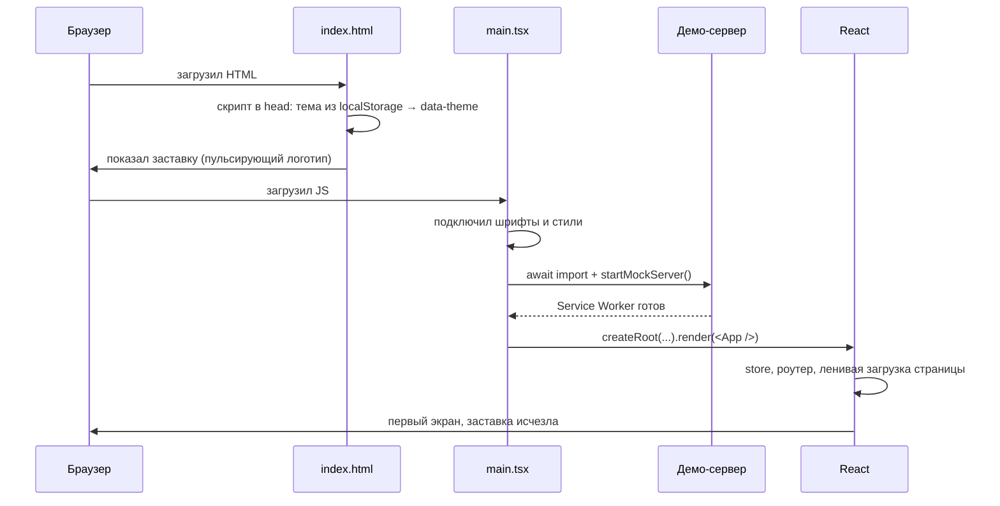

# 11. Каркас и запуск приложения

| Файл | Роль |
| --- | --- |
| [index.html](../../index.html) | заставка и тема до загрузки JS |
| [app/entrypoint/main.tsx](../../src/app/entrypoint/main.tsx) | точка входа: стили, демо-сервер, React |
| [app/entrypoint/app.tsx](../../src/app/entrypoint/app.tsx) | store + роутер |
| [app/routes/router.tsx](../../src/app/routes/router.tsx) | какие адреса — какие страницы |
| [widgets/app-shell/ui/app-shell.tsx](../../src/widgets/app-shell/ui/app-shell.tsx) | меню, клавиша N, нижние вкладки, форма и тосты |
| [shared/lib/use-hide-on-scroll.ts](../../src/shared/lib/use-hide-on-scroll.ts) | спрятать меню при прокрутке вниз |

## Что происходит от открытия вкладки до первого экрана



## index.html — две хитрости до JavaScript

**Тема без мигания.** Если ждать React, первые полсекунды тёмная тема будет светлой: стили
применятся раньше, чем JS узнает о выбранной теме. Поэтому в `<head>` — крошечный скрипт:

```html
<script>
  try {
    const theme = localStorage.getItem('saldo:theme')
    if (theme) document.documentElement.dataset.theme = theme   // <html data-theme="dark">
  } catch {}
</script>
```

Он выполняется **до** отрисовки страницы. `try/catch` — в приватном режиме доступ к
localStorage может быть запрещён.

**Заставка.** Внутри `<div id="root">` лежит заставка с логотипом. Когда React отрисует
приложение, он заменит всё содержимое `#root`, и заставка исчезнет сама, без кода.

## main.tsx — порядок важен

```tsx
import '@fontsource-variable/onest'          // шрифты
import '../styles/index.scss'                // глобальные стили и цвета тем

const { startMockServer } = await import('@/shared/mock')
await startMockServer()                      // ① сначала сервер

createRoot(document.getElementById('root')!).render(   // ② потом приложение
  <StrictMode><App /></StrictMode>,
)
```

Почему сначала сервер: первые запросы RTK Query уходят сразу после отрисовки. Если Service
Worker ещё не готов, они уйдут в настоящую сеть и получат 404.

`await` прямо в файле (вне функции) — «top-level await», так можно в ES-модулях.

`<StrictMode>` — режим разработки, который нарочно запускает эффекты дважды. Так он находит
эффекты без правильной очистки. Именно он нашёл баг «destroy is not a function» ([урок 1](../lessons.md)).

## app.tsx — store и роутер

```tsx
export function App() {
  const [store] = useState(makeStore)
  return (
    <Provider store={store}>
      <RouterProvider router={router} />
    </Provider>
  )
}
```

`useState(makeStore)` — передаём **функцию**, а не её результат. React вызовет её один раз при
первом рендере («ленивая инициализация»). `useState(makeStore())` создавал бы новый store на
каждой перерисовке и тут же выбрасывал бы его.

`Provider` делает store доступным всем компонентам ниже: `useAppSelector` и `useAppDispatch`
берут его отсюда.

## router.tsx — адреса и страницы

```tsx
export const router = createBrowserRouter(
  [
    {
      path: '/',
      Component: AppShell,                  // каркас вокруг всех страниц
      ErrorBoundary: RouteError,            // если страница упала — вместо белого экрана
      HydrateFallback: RouteFallback,       // пока грузится код первой страницы
      children: [
        { index: true, lazy: async () => ({ Component: (await import('@/pages/dashboard')).DashboardPage }) },
        { path: 'transactions', lazy: async () => ({ Component: (await import('@/pages/transactions')).TransactionsPage }) },
        // …
        { path: '*', lazy: … NotFoundPage },   // любой другой адрес
      ],
    },
  ],
  { basename: import.meta.env.BASE_URL.replace(/\/$/, '') || '/' },
)
```

- **Вложенные маршруты.** `AppShell` — родитель, страницы — дети. В `AppShell` есть
  `<Outlet />`: это место, куда роутер подставит текущую страницу. Меню остаётся, меняется только середина.
- **`index: true`** — страница для самого `/`.
- **`lazy`** — код страницы загружается, только когда на неё перешли. Recharts (графики) не
  скачивается, пока не откроете страницу с графиком.
- **`basename`** — на GitHub Pages сайт живёт в `/saldo/`, роутер должен это знать.

## AppShell — каркас

### Горячая клавиша N

```tsx
useEffect(() => {
  function onKey(event: KeyboardEvent) {
    if (event.key.toLowerCase() !== 'n' && event.key.toLowerCase() !== 'т') return  // ①
    if (event.metaKey || event.ctrlKey || event.altKey || event.repeat) return       // ②
    const target = event.target
    if (target instanceof Element && target.closest('input, textarea, select, [contenteditable], dialog')) return  // ③
    event.preventDefault()
    dispatch(formOpened())
  }
  window.addEventListener('keydown', onKey)
  return () => window.removeEventListener('keydown', onKey)                           // ④
}, [dispatch])
```

1. «n» или «т» — та же клавиша в русской раскладке.
2. Не реагируем на Ctrl+N (новое окно браузера) и на зажатую клавишу (`repeat`).
3. Печатаете «n» в заметке — форма открываться не должна. `closest(…)` проверяет, не внутри
   ли поля ввода или окна нажата клавиша. `instanceof Element` — у событий на `window` цель
   не элемент, и `closest` упал бы ([урок 3](../lessons.md)).
4. Очистка: компонент исчез — снять обработчик. Без этого после каждой перезагрузки модуля в
   разработке обработчиков становилось бы больше, и форма открывалась бы по несколько раз.

### Прокрутка наверх при смене страницы

```tsx
useEffect(() => {
  window.scrollTo(0, 0)
}, [pathname])
```

В обычном сайте новая страница открывается сверху. В SPA страница не перезагружается, и без
этого кода вы попали бы на «Бюджеты», прокрученные туда же, где была «Главная».

Фигурные скобки здесь обязательны. `useEffect(() => window.scrollTo(0, 0))` вернул бы
результат `scrollTo` как функцию очистки — именно это уронило приложение в [уроке 1](../lessons.md).

### Ссылка «К содержимому»

```tsx
<a href="#main" className={s.skip}>К содержимому</a>
```

Невидима, пока на неё не попадёт фокус. Человек с клавиатурой нажимает Tab первый раз — видит
ссылку, Enter — прыгает сразу к странице, минуя меню из шести пунктов.

### Меню: NavLink

```tsx
<NavLink to={to} end={end} className={({ isActive }) => cx(s.link, isActive && s.active)}>
  <Icon aria-hidden />{label}
</NavLink>
```

`NavLink` — ссылка, которая знает, активна ли она сейчас. `className` можно передать
функцией: получаем `isActive` и подсвечиваем текущий раздел. `end` для «Обзора» (`/`) —
иначе `/` считался бы активным на всех страницах, ведь все адреса начинаются с `/`.

### Нижние вкладки на телефоне

```tsx
const tabbarHidden = useHideOnScroll()
<nav aria-label="Разделы" className={cx(s.tabbar, tabbarHidden && s.tabbarHidden)}>
```

Хук ([use-hide-on-scroll.ts](../../src/shared/lib/use-hide-on-scroll.ts)) следит за прокруткой:

```ts
function update() {
  const max = document.documentElement.scrollHeight - window.innerHeight
  const y = Math.min(Math.max(window.scrollY, 0), max)    // обрезать «резинку» iOS
  const delta = y - last
  if (y < top || y >= max - 2) setHidden(false)            // у верха и у конца — показать
  else if (Math.abs(delta) < threshold) return             // дрожание пальца — не реагировать
  else setHidden(delta > 0)                                // вниз — спрятать, вверх — показать
  last = y
}
const onScroll = () => { frame ||= requestAnimationFrame(update) }   // не чаще раза за кадр
```

- `frame ||= …` — «если кадр ещё не запланирован, запланировать». Событий `scroll` бывает
  больше 100 в секунду, а считать нужно не чаще, чем экран обновляется.
- `{ passive: true }` у слушателя — обещание браузеру не вызывать `preventDefault`. Тогда он
  прокручивает страницу, не дожидаясь нашего кода.

Само движение — CSS: `.tabbarHidden { transform: translateY(calc(100% + 24px)) }` с плавным
`transition`. `+ 24px` — кнопка «+» выступает над меню и должна уехать вместе с ним.

### Одна форма и одни тосты на всё приложение

```tsx
      <TransactionFormModal />
      <Toaster />
    </div>
```

Последние строки каркаса. Форма и тосты смонтированы один раз, а показываются по экшенам из
любого места (страницы 4 и 6).

## Проверьте себя

1. Почему `useState(makeStore)`, а не `useState(makeStore())`?
2. Что увидит пользователь, если перенести `startMockServer()` после `render`?
3. На какой элемент попадает фокус при первом нажатии Tab на любой странице?

<details>
<summary>Ответы</summary>

1. С функцией React вызовет её один раз. С `makeStore()` store создавался бы на каждой
   перерисовке (хотя использовался бы только первый) — лишняя работа и подписки.
2. Ошибки загрузки в карточках: первые запросы ушли бы в сеть, где сервера нет. После
   «Повторить» всё заработало бы — Service Worker уже готов.
3. На ссылку «К содержимому».
</details>
